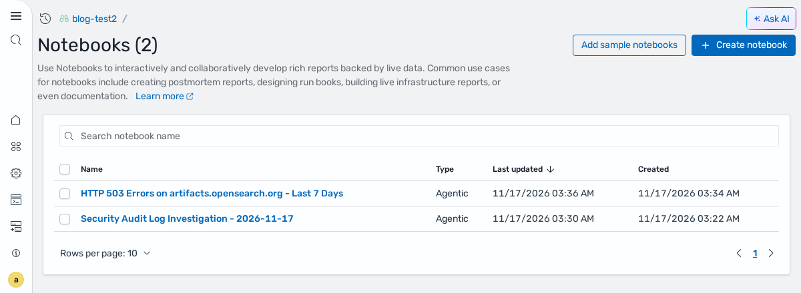
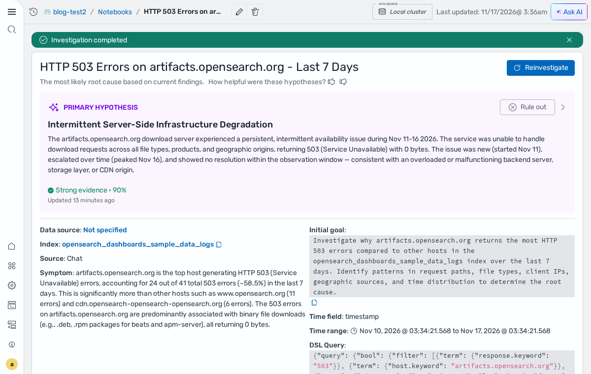
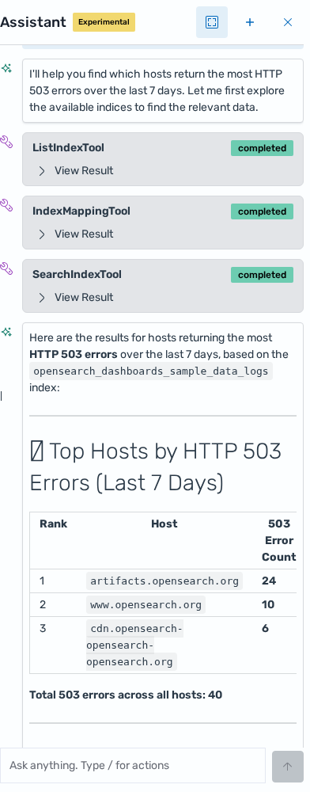
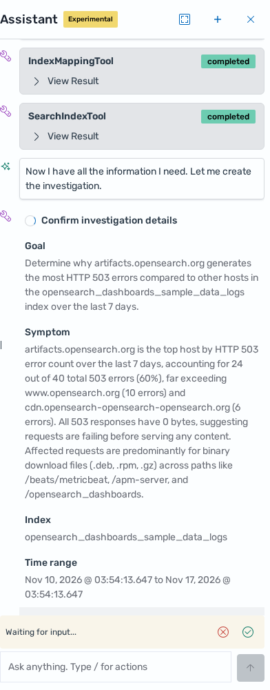

OpenSearch's intelligent assistant capabilities provide advanced chatbot and investigation features. Setting up these features requires careful configuration of multiple components, from the OpenSearch backend to the OpenSearch Dashboards frontend and Model Context Protocol (MCP) server integration.

This comprehensive guide presents the entire setup process, covering everything from basic configuration to advanced features such as streaming output, agent frameworks, and local development workflows. Whether you're contributing to the project or exploring its capabilities, this guide provides the foundation you need to get started with OpenSearch's AI-powered features.

## Local development setup

For local development, you can configure and run both backend and frontend components.

### Backend setup

For the backend setup, follow these steps:

1. Download and extract OpenSearch 3.5.0 from [the downloads page](https://opensearch.org/downloads):

    ```bash
    tar -xzf opensearch-3.5.0-linux-x64.tar.gz
    ```

2. Download the `transport-reactor-netty4` and `arrow-flight-rpc` plugins for 3.5.0 and install them:

    ```bash
    cd opensearch-3.5.0/
    curl -O https://artifacts.opensearch.org/releases/plugins/transport-reactor-netty4/3.5.0/transport-reactor-netty4-3.5.0.zip
    curl -O https://artifacts.opensearch.org/releases/plugins/arrow-flight-rpc/3.5.0/arrow-flight-rpc-3.5.0.zip
    ./bin/opensearch-plugin install --batch file://$PWD/transport-reactor-netty4-3.5.0.zip
    ./bin/opensearch-plugin install --batch file://$PWD/arrow-flight-rpc-3.5.0.zip
    ```

#### Backend configuration

Complete the following steps before you start OpenSearch for the first time.

1. Configure OpenSearch by adding the following settings to your `config/opensearch.yml` file. Use single quotes around the regular expressions. In YAML, a backslash such as `\.` inside double quotes is an invalid escape sequence and prevents OpenSearch from starting:

    ```yaml
    # Enable stream transport feature
    opensearch.experimental.feature.transport.stream.enabled: true

    # HTTP transport type
    http.type: reactor-netty4-secure

    # ML Commons plugin settings
    plugins.ml_commons.agent_framework_enabled: true
    plugins.ml_commons.index_insight_feature_enabled: true
    plugins.ml_commons.stream_enabled: true
    plugins.ml_commons.ag_ui_enabled: true
    plugins.ml_commons.mcp_connector_enabled: true
    plugins.ml_commons.trusted_connector_endpoints_regex: ['^https?://localhost.*', '^https?://127\.0\.0\.1.*', '^https://bedrock-runtime\..*\.amazonaws\.com/.*$']
    ```

2. Install the security demo configuration. Set `OPENSEARCH_JAVA_HOME` to a Java 21 installation. The installer script is not executable in the tarball, so run it with `bash`:

    ```bash
    # Set initial admin password
    # Install OpenSearch Security demo configuration (includes certificates and default security settings)
    OPENSEARCH_INITIAL_ADMIN_PASSWORD='<your_password>' \
    OPENSEARCH_JAVA_HOME=<path_to_java_21> \
    bash ./plugins/opensearch-security/tools/install_demo_configuration.sh -y -i -s
    ```

    On macOS, you can use `$(/usr/libexec/java_home -v 21)` as the Java path.

3. Configure JVM options by adding the following configuration to your `config/jvm.options` file:

    ```bash
    # Streaming setup for Arrow Flight RPC
    -Dio.netty.allocator.numDirectArenas=1
    -Dio.netty.noUnsafe=false
    -Dio.netty.tryUnsafe=true
    -Dio.netty.tryReflectionSetAccessible=true
    ```

4. Start OpenSearch:

    ```bash
    ./bin/opensearch
    ```

5. In a separate terminal, start an OpenSearch MCP server for tool integration:

    ```bash
    # Configure and start MCP server with your OpenSearch credentials
    OPENSEARCH_URL="<your_opensearch_endpoint>" \
    OPENSEARCH_USERNAME="<your_username>" \
    OPENSEARCH_PASSWORD="<your_password>" \
    OPENSEARCH_SSL_VERIFY="false" \
    uvx opensearch-mcp-server-py --transport stream --port 8080
    ```

### Frontend setup

For the frontend setup, download OpenSearch Dashboards 3.5.0 from [the downloads page](https://opensearch.org/downloads):

```bash
# Extract the tar package
tar -xzf opensearch-dashboards-3.5.0-linux-x64.tar.gz
cd opensearch-dashboards-3.5.0

# Start OpenSearch Dashboards
./bin/opensearch-dashboards
```

#### Frontend configuration

Configure OpenSearch Dashboards by editing the `config/opensearch_dashboards.yml` file. The default file in the 3.5.0 distribution already contains `opensearch.hosts`, `opensearch.ssl.verificationMode`, `opensearch.username`, `opensearch.password`, `opensearch.requestHeadersWhitelist`, and several `opensearch_security.*` settings. Remove those existing entries before adding the following settings. Duplicate keys prevent OpenSearch Dashboards from starting:

```yaml
# OpenSearch Connection
opensearch.hosts: [https://localhost:9200]
opensearch.ssl.verificationMode: none
opensearch.username: "admin"
opensearch.password: '<your_password>'  # Replace with your password
opensearch.requestHeadersWhitelist: [authorization, securitytenant]

# Security Plugin Settings
opensearch_security.multitenancy.enabled: false
opensearch_security.cookie.secure: false

# Dashboard Administration
opensearchDashboards.dashboardAdmin.users: ['admin']

# Core Features
workspace.enabled: true
data_source.enabled: true
contextProvider.enabled: true
explore.enabled: true

# Chat and Assistant Features
chat.enabled: true
chat.mlCommonsAgentId: '<your_agent_id>'  # Replace with your agent ID
assistant.enabled: true
assistant.chat.enabled: false
assistant.next.enabled: true
assistant.text2viz.enabled: true
assistant.alertInsight.enabled: true
assistant.smartAnomalyDetector.enabled: true
assistant.incontextInsight.enabled: true

# Investigation Features
investigation.enabled: true
investigation.agenticFeaturesEnabled: true

# Query Enhancements
queryEnhancements.queryAssist.summary.enabled: true

# Security and Permissions
savedObjects.permission.enabled: true
opensearch.ignoreVersionMismatch: true
data_source.ssl.verificationMode: none

# UI Settings
uiSettings:
  overrides:
    'home:useNewHomePage': true
```

The workspace feature doesn't work with security multi-tenancy. If tenancy stays on, creating a workspace in the default Private tenant fails with `strict_dynamic_mapping_exception ... dynamic introduction of [permissions]`. Turn tenancy off in the Security plugin as well:

```bash
curl -XPUT -k -u 'admin:<your_password>' \
  'https://localhost:9200/_plugins/_security/api/tenancy/config' \
  -H 'Content-Type: application/json' \
  -d '{"multitenancy_enabled": false, "private_tenant_enabled": false, "default_tenant": "Global"}'
```

## Configuring chatbot features

To set up chatbot features, follow these steps.

### Step 1: Create a model and connector

Register a Claude model with an Amazon Bedrock connector. This guide uses Claude Sonnet 4.6. You can use any Claude model that is enabled for your account and supports the Amazon Bedrock Converse API. Older models may be rejected with a `ResourceNotFoundException` error if the model is marked as legacy:

```bash
POST /_plugins/_ml/models/_register
{
    "name": "Claude Sonnet 4.6",
    "function_name": "remote",
    "description": "claude model",
    "connector": {
        "name": "Bedrock Converse Connector",
        "description": "Bedrock Converse Connector",
        "version": 1,
        "protocol": "aws_sigv4",
        "parameters": {
            "region": "us-west-2",
            "model": "us.anthropic.claude-sonnet-4-6",
            "service_name": "bedrock",
            "disable_profile_file": true,
            "disable_ec2_metadata": true
        },
        "credential": {
            "access_key": "{{aws-access-key-id}}",
            "secret_key": "{{aws-secret-access-key}}",
            "session_token": "{{aws-session-token}}"
        },
        "actions": [
            {
                "action_type": "predict",
                "method": "POST",
                "url": "https://bedrock-runtime.${parameters.region}.amazonaws.com/model/${parameters.model}/converse",
                "request_body": "{\"system\": [{\"text\": \"${parameters.system_prompt}\"}],\"messages\": [${parameters._chat_history:-}{\"role\":\"user\",\"content\":[{\"text\":\"${parameters.prompt}\"}]}${parameters._interactions:-}]${parameters.tool_configs:-}}"
            }
        ]
    }
}
```

Note the `model_id` in the response; you'll use it in the following steps. The `session_token` field is required only for temporary credentials. Remove it if you use long-term access keys.

### Step 2: Register an MCP connector

Create an MCP connector for tool integration:

```bash
POST _plugins/_ml/connectors/_create
{
  "name": "OpenSearch MCP Server",
  "description": "OpenSearch MCP Server",
  "version": 1,
  "protocol": "mcp_streamable_http",
  "url": "http://localhost:8080",
  "parameters": {
    "endpoint": "/mcp/"
  }
}
```

Note the `connector_id` in the response; you'll use it in the following steps.

### Step 3: Register an AG-UI agent

Create an Agent-User Interaction (AG-UI) main chatbot agent. Provide the `model_id` from Step 1 and use the `connector_id` from Step 2 as the `mcp_connector_id` value:

```bash
POST /_plugins/_ml/agents/_register
{
    "name": "AG-UI chat agent",
    "type": "AG_UI",
    "description": "this is a test agent",
    "llm": {
        "model_id": "{{model_id}}",
        "parameters": {
            "max_iteration": 50,
            "system_prompt": "You are a helpful assistant. Use the available tools to help users. When you need to perform an action, use the appropriate tool by calling it with the correct parameters.",
            "prompt": "Context:${parameters.context}\\nQuestion:${parameters.question}"
        }
    },
    "memory": {
        "type": "conversation_index"
    },
    "parameters": {
        "_llm_interface": "bedrock/converse/claude",
        "mcp_connectors": [
            {
                "mcp_connector_id": "{{mcp_connector_id}}"
            }
        ]
    },
    "tools": [
        {
            "type": "IndexMappingTool",
            "name": "IndexMappingTool"
        }
    ]
}
```

Next, edit the `opensearch_dashboards.yml` file and change the value of `chat.mlCommonsAgentId` to the ID of the AG-UI agent you just registered. Then restart OpenSearch Dashboards. Don't use the plan-execute-reflect agent that you create later for investigations. The chat panel sends AG-UI requests, which that agent can't handle. When this happens, the chat panel shows no reply and no error.

Starting with OpenSearch 3.9, you can choose the ID yourself by adding `"agent_id"` to the register agent request body, for example `"agent_id": "ag-ui-chat-agent"`. Connectors, models, model groups, and memory containers accept custom IDs as well. With fixed IDs, you can write `opensearch_dashboards.yml` before you register anything. You also don't need to copy IDs between steps.

## Configuring investigation features

To configure investigation features, follow these steps.

### Step 1: Create a memory container

Configure memory management for investigation workflows:

```bash
POST _plugins/_ml/memory_containers/_create
{
    "name": "test container",
    "description": "this is a test container",
    "configuration": {
        "index_prefix": "test1",
        "disable_history": false,
        "disable_session": false,
        "use_system_index": false
    }
}
```

Note the `memory_container_id` in the response; you'll use it in the following steps.

### Step 2: Create an investigation connector

Create a connector for investigation features:

```bash
POST _plugins/_ml/connectors/_create
{
    "name": "Amazon Bedrock Claude Sonnet 4.6 connector",
    "description": "Connector to Amazon Bedrock service for the Claude model",
    "version": 1,
    "protocol": "aws_sigv4",
    "parameters": {
        "region": "us-west-2",
        "service_name": "bedrock",
        "model": "us.anthropic.claude-sonnet-4-6"
    },
    "credential": {
        "access_key": "{{aws-access-key-id}}",
        "secret_key": "{{aws-secret-access-key}}",
        "session_token": "{{aws-session-token}}"
    },
    "actions": [
        {
            "action_type": "predict",
            "method": "POST",
            "url": "https://bedrock-runtime.${parameters.region}.amazonaws.com/model/${parameters.model}/converse",
            "headers": {
                "content-type": "application/json"
            },
            "request_body": "{ \"system\": [{\"text\": \"${parameters.system_prompt}\"}], \"messages\": [${parameters._chat_history:-}{\"role\":\"user\",\"content\":[{\"text\":\"${parameters.prompt}\"}]}${parameters._interactions:-}]${parameters.tool_configs:-} }"
        }
    ]
}
```

Note the `connector_id` in the response; you'll use it in the following steps.

### Step 3: Register an investigation model

Register a model for investigation features:

```bash
POST _plugins/_ml/models/_register
{
    "name": "Bedrock Claude Sonnet 4.6",
    "function_name": "remote",
    "description": "Bedrock Claude model",
    "connector_id": "{{connector_id}}"
}
```

Note the `model_id` in the response; you'll use it in the following steps.

### Step 4: Register an investigation MCP connector

Register an MCP connector for investigation tools:

```bash
POST _plugins/_ml/connectors/_create
{
    "name": "My MCP Server Connector",
    "description": "Connector to MCP server",
    "version": "1",
    "protocol": "mcp_streamable_http",
    "url": "http://localhost:8080",
    "parameters": {
      "endpoint": "/mcp/"
  }
}
```

Note the `connector_id` in the response; you'll use it in the following steps.

### Step 5: Register an investigation agent

Create a plan-execute-reflect agent for complex investigations. Provide the `model_id` from Step 3, the `memory_container_id` from Step 1, and use the `connector_id` from Step 4 as the `mcp_connector_id` value:

```bash
POST _plugins/_ml/agents/_register
{
    "name": "My Plan Execute Reflect Agent",
    "type": "plan_execute_and_reflect",
    "description": "Agent for dynamic task planning and reasoning",
    "llm": {
      "model_id": "{{model_id}}",
      "parameters": {
        "prompt": "please help me answer the question."
      }
    },
    "memory": {
      "type": "AGENTIC_MEMORY",
      "memory_container_id": "{{memory_container_id}}"
    },
    "parameters": {
      "_llm_interface": "bedrock/converse/claude",
      "llm_response_filter": "$.output.message.content[0].text",
      "mcp_connectors": "[{\"mcp_connector_id\":\"{{mcp_connector_id}}\"}]"
    },
    "tools": [
      {
        "type": "IndexMappingTool"
      }
    ],
    "app_type": "os_chat"
}
```

### Step 6: Configure investigation settings

Register an agent for investigation features, providing the `agent_id` from Step 5:

```bash
POST .plugins-ml-config/_doc/os_deep_research
{
    "type": "os_deep_research",
    "configuration": {
      "agent_id": "{{agent_id}}"
    }
}
```

#### Troubleshooting tip

You may encounter the following error:

```json
{
  "error": {
    "root_cause": [
      {
        "type": "security_exception",
        "reason": "no permissions for [] and User [name=admin, backend_roles=[admin], requestedTenant=]"
      }
    ],
    "type": "security_exception",
    "reason": "no permissions for [] and User [name=admin, backend_roles=[admin], requestedTenant=]"
  },
  "status": 403
}
```

To resolve the error, use a curl command with certificate authentication to bypass the security restrictions. Replace `<your_agent_id>` with the `agent_id` from Step 5:

```bash
curl -k --cert opensearch-3.5.0/config/kirk.pem --key opensearch-3.5.0/config/kirk-key.pem \
  -XPOST 'https://localhost:9200/.plugins-ml-config/_doc/os_deep_research' \
  -H 'Content-Type: application/json' \
  -d '{
    "type": "os_deep_research",
    "configuration": {
      "agent_id": "<your_agent_id>"
    }
  }'
```

For more information about system indexes and security configuration, see the [System indexes](https://docs.opensearch.org/latest/security/configuration/system-indices/).

### Step 7: Enable index insight configuration

Enable the index insight feature for investigation capabilities:

```bash
curl -k --cert opensearch-3.5.0/config/kirk.pem --key opensearch-3.5.0/config/kirk-key.pem \
  -XPOST 'https://localhost:9200/.plugins-ml-index-insight-config/_doc/03000200-0400-0500-0006-000700080009' \
  -H 'Content-Type: application/json' \
  -d '{ "is_enable": true }'
```


## Using OpenSearch intelligent assistant features

After completing the configuration, you'll have access to OpenSearch's intelligent assistant capabilities through multiple interfaces. The setup provides the following key components that work together to deliver comprehensive AI-powered functionality.

To try these features on a new cluster, install the sample web logs. On the OpenSearch Dashboards home page, select **Sample datasets** and add **Sample web logs**. The examples in this section use the `opensearch_dashboards_sample_data_logs` index. For instance, ask the chatbot "Which hosts return the most HTTP 503 errors over the last 7 days?", and then use `/investigate` to find out why.

### Investigations

Investigations are accessible through the main OpenSearch Dashboards interface, as shown in the following image.

{: .img-fluid }

### Investigation workflow

Investigations demonstrate advanced AI capabilities, including automated analysis, pattern recognition, and comprehensive reporting based on your data queries, as shown in the following image.

{: .img-fluid }

### Chatbot functionality

The chatbot interface enables real-time conversations with your data, allowing you to ask questions in natural language and receive intelligent responses powered by the configured ML models, as shown in the following image.

{: .img-fluid }

### Triggering an investigation from the chatbot

You can seamlessly trigger investigation workflows directly from the chatbot interface by typing `/investigate` in the input box. This command initiates an investigation session. You can select the links provided in the chatbot responses to navigate to the investigation page, as shown in the following image.

{: .img-fluid }

## Try it 

Now that you've seen how to configure OpenSearch's investigation and chatbot features, we encourage you to try them in your own environment. Follow the setup steps in this guide to enable AI-powered data analysis and natural language interactions with your OpenSearch data.

We'd love to hear about your experience! Share your feedback, questions, and use cases on the [OpenSearch forum](https://forum.opensearch.org/). Your insights help us improve these features and build a stronger open-source community around AI-powered search and analytics.

