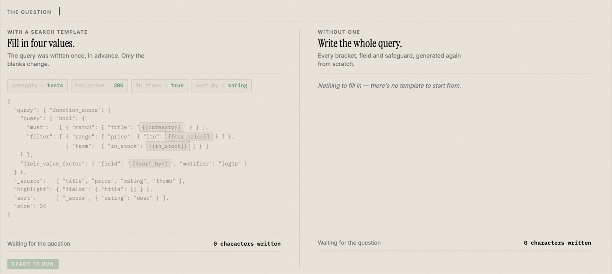

> **TL;DR:** Agentic search can generate an OpenSearch query by filling the parameters of a search template that you register ahead of time. The template defines the query structure, and OpenSearch renders the final query using its Mustache engine. Because the model produces only a few parameter values rather than the full query, token cost and latency are lower, and the query structure stays under your control. 

In earlier versions of OpenSearch, you could provide agentic search with [search templates as examples](https://docs.opensearch.org/latest/vector-search/ai-search/agentic-search/search-templates/), and the large language model (LLM) followed them when it wrote the query. In OpenSearch 3.10, you can register a template so that the LLM fills only its parameters. OpenSearch then renders the query from the stored template. In this post, we'll compare filling a template with writing the full query and describe deriving a parameter schema from a template, choosing between filling templates in OpenSearch and in the agent server, and rewriting parameter descriptions to improve the values that the model generates.

## Prerequisites

Agentic search templates require OpenSearch 3.10 or later and are disabled by default. Multi-tenancy must be disabled. The agent server path requires Amazon Bedrock as the model provider. For the full list of requirements, including the cluster settings and Security plugin permissions for each path, see [Filling search templates](https://docs.opensearch.org/latest/vector-search/ai-search/agentic-search/agentic-search-templates/).

If you have not used agentic search before, see [Agentic search](https://docs.opensearch.org/latest/vector-search/ai-search/agentic-search/).

## Two stages of filling a template

A **search template** is a stored query written in the Mustache templating language. The template contains placeholders for the parts that change for different requests and marks the positions at which a value is substituted. For example, a product search is often a `match` query on the title with an optional category filter, in which the search text and the category are the parts that vary.

Filling a template splits the work into two stages:

- **At registration time**, OpenSearch reads the template body and derives a _parameter schema_: each parameter name and type, whether it is required, a description of what it does, and the values that it may take when the values are restricted to a fixed set. You register the template once, and OpenSearch derives and stores the schema for you.
- **At query time**, the agent provides the model with only the parameter schema and the question. The model returns values for those parameters, OpenSearch substitutes them into the template to produce the query and runs the query.

The following animation compares the two approaches for the same question.


*For the same question, filling a template (left) has the model write four values, while authoring the query directly (right) has it write the entire request body.*

The cost and latency of a generation request increase with the number of tokens that the model produces. Authoring a full query produces the whole `_search` body, which grows as the query becomes more complex. Filling a template produces only a few values, and that number stays small regardless of the template size. Rendering the template into a query happens in OpenSearch and takes about the same time for a large template as for a small one.

In our testing across five indexes and two models, filling a template that defines substantial query structure ran 3.4 times faster on average than authoring the equivalent query, while emitting far fewer output tokens. The more query structure a template defines, the fewer tokens the model writes, and the greater the improvement in latency and cost. When we paired such a template with a fast model, latency was nearly identical, because the model produced a similar number of tokens in both cases. Filled queries also applied mandatory rules more consistently, because a required filter included in the template does not depend on the model adding it.

## Enabling the template endpoints

The template endpoints are experimental and disabled by default. To enable them, update the following cluster setting:

```json
PUT _cluster/settings
{
  "persistent": {
    "plugins.ml_commons.agentic_search_template_enabled": true
  }
}
```

This setting also enables the `SearchTemplateFillTool` at run time.

For a local walkthrough, enable the following settings:

```json
PUT _cluster/settings
{
  "persistent": {
    "plugins.ml_commons.trusted_connector_endpoints_regex": [
      "^http://127\\.0\\.0\\.1:8001/.*$",
      "^https://bedrock-runtime\\..*[a-z0-9-]\\.amazonaws\\.com/.*$"
    ],
    "plugins.ml_commons.connector.private_ip_enabled": true
  }
}
```

Scope the `127.0.0.1:8001` pattern to your agent server's real host. Replacing the regex list removes the defaults, so the preceding list keeps the default Amazon Bedrock runtime pattern, which the `SearchTemplateFillTool` example in this post uses. Restore any other model provider endpoints that your cluster relies on. For more information about these settings, see [ML Commons cluster settings](https://docs.opensearch.org/latest/ml-commons-plugin/cluster-settings/).

## Registering a search template

Create an index that you will search. This example uses a small product catalog:

```json
PUT products
{
  "mappings": {
    "properties": {
      "title":    { "type": "text", "fields": { "keyword": { "type": "keyword" } } },
      "category": { "type": "keyword" },
      "price":    { "type": "float" }
    }
  }
}
```

Ingest four sample products into the index:

```json
POST /_bulk?refresh=true
{ "index": { "_index": "products", "_id": "1" } }
{ "title": "leather dress shoes", "category": "footwear", "price": 210.0 }
{ "index": { "_index": "products", "_id": "2" } }
{ "title": "trail running shoes", "category": "footwear", "price": 120.0 }
{ "index": { "_index": "products", "_id": "3" } }
{ "title": "canvas shoes", "category": "footwear", "price": 45.0 }
{ "index": { "_index": "products", "_id": "4" } }
{ "title": "wool hiking socks", "category": "apparel", "price": 18.0 }
```


Next, store the search template as a Mustache script. Store the body as a string, not as a JSON object: a body that uses conditional sections such as `{{#category}}` is not valid JSON until it renders:

```json
PUT _scripts/product_search
{
  "script": {
    "lang": "mustache",
    "source": "{\"query\":{\"bool\":{\"must\":[{\"match\":{\"title\":\"{{query_text}}\"}}],\"filter\":[{{#category}}{\"term\":{\"category\":\"{{category}}\"}}{{/category}}]}},{{#sort_by}}\"sort\":[{\"{{sort_by}}\":\"desc\"}],{{/sort_by}}\"size\":{{size}}}"
  }
}
```

The following example is the preceding template in an unescaped form. The placeholders are the parts that the model fills: `query_text` is the search text, `category` is an optional filter, `sort_by` specifies a field to sort on, and `size` sets the number of results:

```json
{
  "query": {
    "bool": {
      "must": [ { "match": { "title": "{{query_text}}" } } ],
      "filter": [
        {{#category}}{ "term": { "category": "{{category}}" } }{{/category}}
      ]
    }
  },
  {{#sort_by}}"sort": [ { "{{sort_by}}": "desc" } ],{{/sort_by}}
  "size": {{size}}
}
```


Wrapping `category` and `sort_by` in Mustache sections marks them as optional: when the model omits one, the rendered query does not include that clause.

Next, register the template as an agentic search template so that the agent can use it. Provide the template ID and the index that it targets. A description is optional; if you omit it, OpenSearch derives one from the template body:

```json
POST /_plugins/_ml/agentic_search_templates
{
  "template_id": "product_search",
  "index": "products",
  "description": "Product catalog search"
}
```

The response confirms the template was created:

```json
{ "template_id": "product_search", "status": "created" }
```

OpenSearch validates the template, so an invalid template is rejected during registration.

During registration, OpenSearch automatically derives a parameter schema from the template body and index mapping. It identifies each parameter's type, whether it is required, and the available field choices, without calling a model. To view the derived schema, send the following request:

```json
GET /_plugins/_ml/agentic_search_templates/product_search
```

The response contains the `param_schema`:

- `query_text` is required because it has no wrapping Mustache section. Its description names the `title` field because that is the field it searches.
- `category` is optional because Mustache wraps it in its own section (`{{#category}}...{{/category}}`), so the query stays valid when the model omits it.
- `sort_by` contains an `enum` derived from the index mapping. `title` is a `text` field and can't be sorted, so only its `title.keyword` subfield is listed.
- `size` is unquoted in the template, so OpenSearch infers it is a number.

The full schema is as follows:

```json
{
  "query_text": {
    "type": "string",
    "required": true,
    "description": "Full-text query matched against the title field."
  },
  "category": {
    "type": "string",
    "required": false,
    "description": "Filter by exact category value."
  },
  "sort_by": {
    "type": "string",
    "required": false,
    "description": "Field to sort results by.",
    "enum": [ "category", "price", "title.keyword" ],
    "source": "mapping"
  },
  "size": {
    "type": "number",
    "required": true,
    "description": "Number of results to return."
  }
}
```

Those descriptions and allowed values are the information that the model receives when it generates a value for each parameter, so adjusting them has the largest effect on the generated values. For more information, see [Improving results by describing your parameters](#improving-results-by-describing-your-parameters). To bypass derivation entirely, pass your own `param_schema` in the register request; OpenSearch validates and stores it as sent.

OpenSearch also derives a one-line description of the template as a whole, which it stores when you don't supply your own. If you omit `description` from the preceding register request, the stored description is as follows:

```text
Full-text search over title; filters by category; sortable.
```

The agent compares template descriptions when it selects among several templates.

## Connecting the template to a search pipeline

Registering a template makes it available for use but does not associate it with a search request. A flow agent fills the template, while a search pipeline specifies which agent OpenSearch runs. You can either register the flow agent directly in OpenSearch or configure it to call an agent server. The search pipeline configuration is the same for both approaches.

Choose OpenSearch to fill templates if you want all processing to run within the cluster, use a model provider other than Amazon Bedrock, or want fill failures to be returned as errors.

Choose the agent server if you already run it with Amazon Bedrock and prefer to fall back to generating the query directly whenever template filling fails.

### Filling templates in OpenSearch

In OpenSearch, the `SearchTemplateFillTool` calls the model and renders the template within the cluster. To use it, first create a connector to your model provider.

The tool requires the model to return the template parameters through a tool call. Therefore, the connector's `request_body` must include `${parameters.tool_configs:-}`, `${parameters.system_prompt}`, and either `${parameters.user_prompt}` or `${parameters.prompt}`.

The connectors described in [Model configuration](https://docs.opensearch.org/latest/vector-search/ai-search/agentic-search/agent-customization/?utm_source=chatgpt.com#model-configuration) already meet these requirements. 

Then register and deploy an externally hosted model that uses the connector, providing the `connector_id` from the connector response:

```json
POST /_plugins/_ml/models/_register?deploy=true
{
  "name": "Bedrock Claude Sonnet 4.5",
  "function_name": "remote",
  "connector_id": "PASTE_CONNECTOR_ID"
}
```

Next, register a flow agent containing the `SearchTemplateFillTool`. Specify the model and its `_llm_interface` in the tool `parameters` and list the templates that the agent may fill in the `template_ids` field of the tool's `config` as a JSON string:

```json
POST /_plugins/_ml/agents/_register
{
  "name": "Agentic Search Template-Fill Agent",
  "type": "flow",
  "tools": [
    {
      "type": "SearchTemplateFillTool",
      "parameters": {
        "model_id": "PASTE_MODEL_ID",
        "_llm_interface": "bedrock/converse/claude",
        "response_filter": "$.output.message.content[0].text"
      },
      "config": {
        "template_ids": "[\"product_search\"]"
      }
    }
  ]
}
```

The `response_filter` parameter is used only when the tool defaults to writing the query directly. Use the `agent_id` from the response when you [create the search pipeline](#creating-the-search-pipeline).

### Filling templates in the agent server

When using the agent server, a connector describes the call to the agent server and a flow agent uses the connector. Start by creating the connector. The following connector fields control filling the template that sending the question to the agent server:

- `parameters` contains the static values, including the `template_id` to fill. Set `endpoint` to your agent server host.
- `request_body` is a template for the JSON payload. OpenSearch substitutes each `${parameters.<name>}` placeholder before sending by reading `question` and `index_name` from the search request at query time and `template_id` from the preceding static parameters:

```json
POST /_plugins/_ml/connectors/_create
{
  "name": "Agentic Search Template-Fill Connector",
  "description": "Calls the agent server in template-fill mode.",
  "version": "1",
  "protocol": "http",
  "parameters": {
    "endpoint": "127.0.0.1:8001",
    "template_id": "product_search"
  },
  "credential": {
    "token": "replace-with-agent-server-token"
  },
  "actions": [
    {
      "action_type": "predict",
      "method": "POST",
      "url": "http://${parameters.endpoint}/invoke",
      "headers": {
        "Content-Type": "application/json",
        "Authorization": "Bearer ${credential.token}"
      },
      "request_body": "{\"query\":\"${parameters.question}\",\"agent\":\"agentic_search\",\"context\":{\"index_name\":\"${parameters.index_name}\",\"template_id\":\"${parameters.template_id}\"},\"response_format\":\"inference_results\"}",
      "post_process_function": "connector.post_process.mlcommons.passthrough"
    }
  ]
}
```

The following listing shows the `request_body` formatted for readability:

```json
{
  "query": "${parameters.question}",
  "agent": "agentic_search",
  "context": {
    "index_name": "${parameters.index_name}",
    "template_id": "${parameters.template_id}"
  },
  "response_format": "inference_results"
}
```

The `context.template_id` key selects the template to fill; without it, the same connector writes the query directly. The `response_format: inference_results` field specifies to the agent server to return the generated query wrapped in the `inference_results` JSON structure that the `post_process_function` in the preceding connector expects.

One consequence of defining `template_id` in the connector is that the template is chosen when you register the connector. To support several query shapes, register a connector and agent for each or use a candidate set, as described in [Choosing among several templates](#choosing-among-several-templates).

Next, register a flow agent that calls the connector. Specify the `connector_id` returned in the previous response:

```json
POST /_plugins/_ml/agents/_register
{
  "name": "Agentic Search Template-Fill Agent",
  "type": "flow",
  "description": "Generates OpenSearch DSL by filling a registered search template.",
  "tools": [
    {
      "type": "ConnectorTool",
      "name": "template_fill_generator",
      "description": "Fills a registered search template from a natural-language question.",
      "parameters": {
        "connector_id": "PASTE_CONNECTOR_ID",
        "connector_action": "predict"
      }
    }
  ]
}
```

### Creating the search pipeline

Finally, create a search pipeline. The `agentic_query_translator` request processor converts an `agentic` clause into a call to your agent and reads the `agent_id` from its own configuration. Specify the `agent_id` of the flow agent that you registered in either of the preceding sections:

```json
PUT /_search/pipeline/product_agentic_pipeline
{
  "request_processors": [
    {
      "agentic_query_translator": {
        "agent_id": "PASTE_AGENT_ID"
      }
    }
  ],
  "response_processors": [
    {
      "agentic_context": {
        "dsl_query": true
      }
    }
  ]
}
```

The response processor is optional. We recommend enabling `dsl_query` during configuration because it returns the generated query alongside your results.

## Asking a question

Once you've configured the pipeline, you can ask a question by running a search request that includes the pipeline and specifies the question in an `agentic` query clause:

```json
POST /products/_search?search_pipeline=product_agentic_pipeline
{
  "query": {
    "agentic": {
      "query_text": "the 2 most expensive footwear shoes"
    }
  }
}
```

When OpenSearch processes the request, the agent sends your question and the schema for `product_search` to the model, and the model returns parameter values. LLM output can vary between runs. In our tests, the `SearchTemplateFillTool` returned the following values:

```json
{ "query_text": "footwear shoes", "sort_by": "price", "size": 2 }
```

OpenSearch substitutes those values into the template and runs the resulting query:

```json
{
  "query": {
    "bool": {
      "must":   [ { "match": { "title": "footwear shoes" } } ],
      "filter": [ ]
    }
  },
  "sort": [ { "price": "desc" } ],
  "size": 2
}
```

The response contains the matching documents from your index. If you enabled `dsl_query`, the `ext.dsl_query` field of the response contains the preceding query. To produce it, the model supplied three values: `query_text`, `sort_by`, and `size`. The sort clause appears because the model filled the optional `sort_by` parameter. The model omitted the optional `category` parameter and kept `footwear` in `query_text`, so the query has no category filter, and products from other categories with titles that match `shoes` can appear in the results. With the sample data, the results are the same as with the filter, because every product whose title matches is in the `footwear` category, but the missing filter shows in `ext.dsl_query`. [Improving results by describing your parameters](#improving-results-by-describing-your-parameters) describes how to keep filter words out of `query_text`.

When the agent server fills the template for this question, it produces the same query. However, it sometimes rejects the template and writes the query directly. In our tests, the agent rejected the template in three of five runs.

## Improving results by describing your parameters

Because the template defines the query structure, the remaining source of error is usually an incorrect parameter value. The schema is the only information the model receives about each parameter. Although the automatically generated descriptions cover common cases, they describe how a parameter is used in the query rather than what its values represent in your data.

For best results, customize the parameter descriptions to reflect your data. In our testing, this had a greater impact on results than switching models or changing the prompt.

Units are a good example. Suppose a template includes a parameter that defines an upper bound for a weight field. OpenSearch can determine that the parameter represents an upper range limit, but it cannot infer the unit from the template. If a user asks for "a tent that weighs under 1.5 kilograms," the model might return `1.5` for a parameter that actually applies to price. Both are numeric values, so the automatically generated description does not provide enough context. Specifying the unit in the description eliminates this ambiguity.

The same principle applies to the preceding `product_search` example:

- `query_text`: Because this parameter is used in a `match` clause, it should contain full-text search terms, not filter values such as `footwear` from the preceding example.
- `sort_by`: The automatically derived choices include every sortable field in the index mapping, including `category`, which this template already uses for filtering. Narrow the list to fields that make sense for sorting.
- `category`: Specify the valid category values so the model knows which values it can use.

We recommend updating the descriptions and allowed values as follows:

```json
PUT /_plugins/_ml/agentic_search_templates/product_search
{
  "param_schema": {
    "query_text": {
      "description": "Product words only, such as a type or material. Do not include filters such as price, category, or availability."
    },
    "category": {
      "description": "Exact product category, one of: footwear, apparel. When the question names a category, set it here and leave it out of query_text."
    },
    "sort_by": {
      "description": "Field to sort results by.",
      "enum": [ "price", "title.keyword" ]
    }
  }
}
```

The update operation merges the new descriptions into the stored schema, so you only need to specify the fields you want to change. Any parameter not referenced in the template body is rejected.

The agent server caches each template schema for up to one minute, so schema updates can take up to a minute to take effect. The `SearchTemplateFillTool` picks up updates immediately.

The following changes to parameter descriptions have the greatest impact on results:

- **Specify units and scale** for numeric parameters. Without this information, the model can easily confuse amounts, durations, and distances across different fields.
- **Describe accepted values and when to use them.** For filter parameters, list the allowed values and explain when to set them. Otherwise, the model might include filter terms in the full-text search parameter.
- **Describe what a parameter should exclude.** Explain what does not belong in a parameter, in addition to what it should contain. In our tests, adding exclusion guidance to the full-text parameter was not sufficient on its own. The results improved when the filter parameter also described its accepted values.
- **Narrow the allowed values** to those relevant to your data. By default, schema derivation lists every mapped field for field-selection parameters, limiting the choices to sortable fields when the parameter specifies a sort field. These lists are often broader than necessary.
- **Specify default values** for optional parameters when schema derivation does not identify one. This helps the model omit the parameter rather than generate an arbitrary value.

These changes are optional. A template with automatically derived descriptions works without any modifications. You can refine the descriptions as you identify questions that produce incorrect results.

## When a template cannot express a question

A template supports a defined set of questions. For example, a user might ask, "What is the average price per category?" This requires an aggregation that the `product_search` template does not support. If the model tries to fill the template anyway, the resulting query might execute successfully but return an answer to the wrong question.

Instead, the model can decline to fill the template. Every template-filling request gives the model a way to indicate that the template cannot express the question. When this happens, agentic search generates the query directly, using the same behavior as when no template is involved. The result is either a filled template for supported questions or a directly generated query for questions the template cannot express.

How other failures are handled depends on where the template is filled:

- **Agent server:** Falls back to generating the query directly for any template-filling failure, including an unreadable template, a failed LLM call, invalid parameter values, or a template that fails to render. These failures are not returned to the caller. If query generation also fails, the agent server returns a `match_all` query.
- **`SearchTemplateFillTool`:** Falls back to direct query generation when the model declines, no usable template exists for the searched index, the model does not call the tool, the parameter values do not match the schema, the model selects a template that is not a candidate, or the template fails to render as a single JSON object. However, it returns an error if it cannot read the registered templates or the LLM call itself fails, for example, because of throttling. To make the tool return an error instead of falling back, set `"fallback_enabled": "false"` in its `config`.

A template that renders successfully but produces a query that does not match the user's intent does not trigger an error on either path. The model's ability to decline helps prevent it from filling templates that cannot express the requested query. However, a declined request requires two generation calls instead of one. As a result, the latency benefit is greatest for questions that your templates can actually support.

## Choosing among several templates

You can register multiple templates for an index and make them available to the agent. For example, you might offer both a keyword search template and a semantic search template. The agent selects the most appropriate template based on the user's question.

With the `SearchTemplateFillTool`, specify the candidate template IDs in the tool's `config` using the `template_ids` field:

```json
{
  "config": {
    "template_ids": "[\"product_search\", \"semantic_product_search\"]"
  }
}
```

Here, `semantic_product_search` represents a second template registered in the same way as `product_search`. On both execution paths, unregistered template IDs are skipped without causing an error. The agent server also logs a warning when it skips an ID.

With the agent server, you need to update two fields in the connector configuration.

First, specify the candidate template IDs in the static parameters and remove the `template_id` entry. If both `template_id` and `template_ids` are specified, the individual ID is included as an additional candidate.

```json
{
  "parameters": {
    "endpoint": "127.0.0.1:8001",
    "template_ids": "[\"product_search\", \"semantic_product_search\"]"
  }
}
```

Next, update the payload to pass `template_ids` in the context instead of `template_id`. Do not enclose the `${parameters.template_ids}` placeholder in quotation marks. The parameter value is already a JSON array, so adding quotation marks produces an invalid payload.

```text
{
  "query": "${parameters.question}",
  "agent": "agentic_search",
  "context": {
    "index_name": "${parameters.index_name}",
    "template_ids": ${parameters.template_ids}
  },
  "response_format": "inference_results"
}
```

Escape the payload and use it as the value of the connector's `request_body` field:

```text
{\"query\":\"${parameters.question}\",\"agent\":\"agentic_search\",\"context\":{\"index_name\":\"${parameters.index_name}\",\"template_ids\":${parameters.template_ids}},\"response_format\":\"inference_results\"}
```

When multiple templates are available, the agent selects the best match and fills it in a single step. It does not make a separate request to select a template before filling it. Both execution paths support up to eight candidate templates.

Template selection is based on the template descriptions, so provide a description when registering each template or review the description that OpenSearch derives automatically.

The two execution paths also differ in how they validate the index associated with each template:

- **`SearchTemplateFillTool`:** Always skips templates registered against a different index.
- **Agent server:** Checks the index only when the request includes two or more distinct template IDs. In this case, the registered index name must exactly match `index_name`.

If no template matches the question, the agent can decline to fill a template and generate the query directly.

## Searches that benefit from templates

Agentic search templates are most useful when the query structure is predictable, even though the search terms and filter values vary. Consider using templates for the following types of searches:

- **Product and catalog search:** Product search applications typically use a consistent query structure. The query matches the user's terms against title and description fields, filters by category, brand, price, and availability, and sorts by relevance or price. The template preserves the relevance configuration you have tuned, while the model supplies the search terms and filter values. For example, questions such as "waterproof jackets under $150, in stock" and "cheapest wool socks" can use the same template.

- **Searches with mandatory filters:** Some applications require every query to include specific filters, such as a tenant identifier, an `is_active` flag, or a visibility or region field. Including these filters in the template ensures they appear in every rendered query. However, templates only constrain the queries generated by the agent. They are not a substitute for document-level security.

- **Searches with manually tuned relevance configurations:** Templates are useful when your queries include field boosts, a `function_score`, or decay functions that require careful tuning. The template preserves this configuration while allowing the model to change search terms and filters without modifying the scoring logic. This approach can also provide greater latency improvements because the model no longer needs to generate the entire query body.

Direct query generation remains a better choice for open-ended searches where the query structure cannot be predicted in advance, as well as analytical questions that require aggregations.

Because the model can decline questions that a template cannot express, you can combine both approaches. Register templates for the searches your application handles most frequently and let the model generate queries directly for everything else.

## Next steps

To try agentic search templates, start by creating a template for a search your application already supports. Ask a question that the template can handle, then compare the generated query in the `ext.dsl_query` field with the query your application currently sends.

Once the template works, refine the automatically derived parameter descriptions to reflect your data. This is the change most likely to improve the parameter values generated by the model.

For more information about the components used in this post, see the following resources:

- [Filling search templates in agentic search](https://docs.opensearch.org/latest/vector-search/ai-search/agentic-search/agentic-search-templates/) — Setup instructions for both the OpenSearch `SearchTemplateFillTool` and the agent server.
- [Agentic search](https://docs.opensearch.org/latest/vector-search/ai-search/agentic-search/) — Configuration reference for agentic search, including supported agent types.
- [Search templates](https://docs.opensearch.org/latest/search-plugins/search-template/) — Reference for Mustache syntax, conditional sections, and the `_render/template` endpoint.
- [Agentic query translator processor](https://docs.opensearch.org/latest/search-plugins/search-pipelines/agentic-query-translator-processor/) — Configuration reference for the search pipeline processor that calls your agent.

Share examples of the queries you have templated, along with questions your templates cannot express, on the [OpenSearch forum](https://forum.opensearch.org/).
