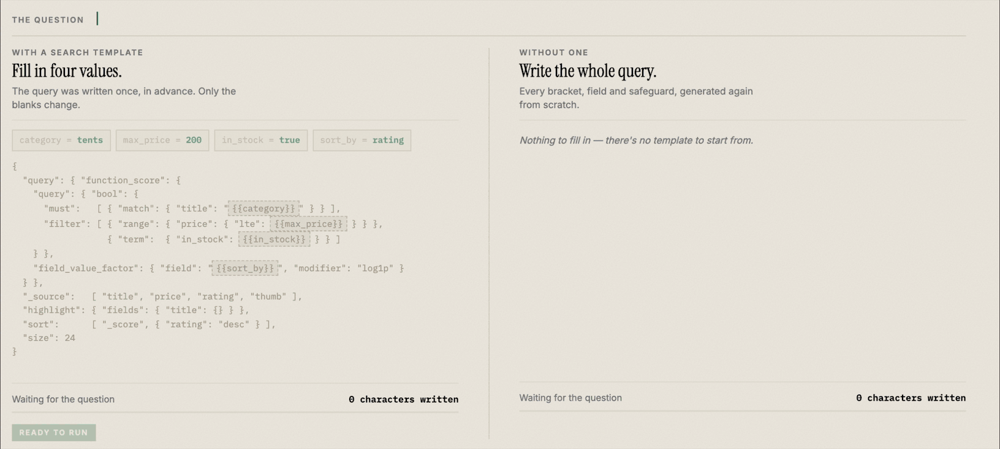

> **TL;DR:** Agentic search can generate an OpenSearch query in two ways: it can author the full `_search` body from a natural-language question or it can fill the parameters of a search template you register ahead of time. When the model fills a template, it supplies a few typed values, the template defines the query structure, and OpenSearch renders the final query with its Mustache engine. Cost and latency scale with how much the model writes, so filling a template lowers both, and you control the query shape. When a template can't express a question, the model declines and agentic search falls back to writing the query directly. The feature is experimental and disabled by default.

[Agentic search](https://opensearch.org/blog/introducing-agentic-search-in-opensearch-transforming-data-interaction-through-natural-language/), introduced in OpenSearch 3.3, lets you include a natural-language question in a search request, which an AI agent converts into an OpenSearch query. You send a `_search` request with an `agentic` query clause, an agent reads your index and produces a `_search` body written in OpenSearch's query domain-specific language (DSL), and OpenSearch runs it and returns results.

This approach requires the model to produce the entire query correctly. A large language model (LLM) can return a query that is invalid, or one that is valid but expresses a different request than the one that you asked for. A query that needs more structure also requires more output, which costs more tokens and more time.

This post describes a different approach. Instead of writing the query, the model fills a template. You register a search template once, the model supplies only its parameter values, and OpenSearch renders the query. The fill step can run in either of two places: in the cluster, using a flow agent with the ML Commons `SearchTemplateFillTool`, or in the [OpenSearch agent server](https://opensearch.org/blog/bringing-intelligence-to-opensearch-introducing-the-opensearch-agent-server/), using a flow agent with a `ConnectorTool` that calls the agent server. Both use the same registered templates and the same search pipeline.

## Prerequisites

Agentic search templates require OpenSearch 3.10 or later. The other prerequisites depend on where the template is filled:

- **Both approaches**: Agentic search templates are not supported when multi-tenancy is enabled.
- **ML Commons**: A remote model whose `_llm_interface` supports forced tool calls: `bedrock/converse/claude`, `openai/v1/chat/completions`, or `gemini/v1beta/generatecontent`. The `SearchTemplateFillTool` reads and renders each stored template as the user running the search, so if your cluster runs the Security plugin, that user needs the `cluster:admin/script/get` permission. A template that the user can't read is not offered to the model.
- **Agent server**:
  - **A running OpenSearch agent server** that is reachable from your cluster. For more information, see [Bringing intelligence to OpenSearch: Introducing the OpenSearch agent server](https://opensearch.org/blog/bringing-intelligence-to-opensearch-introducing-the-opensearch-agent-server/). The configuration described in this blog post registers a flow agent that calls the agent server.
  - **Amazon Bedrock as the agent server's model provider**: Filling a template uses a forced tool call, which the agent server currently implements only for Bedrock. If you use another provider, the fill attempt fails and the request falls back to writing the query directly, so searches continue to work but the template is never used.
  - **Permissions for the connector's credential**, if your cluster runs the Security plugin. The agent server makes its calls to the cluster as the user of the bearer token in the connector's credential. That user needs the `indices:data/read/search/template/render` permission to render templates, granted as a cluster permission in `cluster_permissions`. Granting it as an index permission, even on the `*` index pattern, doesn't allow rendering. The user also needs read access to the `.plugins-ml-agentic-search-templates` system index, which stores the parameter schemas. Because it is a protected system index, the user's role must also grant `system:admin/system_index` on it, and `plugins.security.system_indices.permission.enabled` must be `true`. Without these permissions, the request falls back to writing the query directly without returning an error. When it falls back, the agent server reads the mapping of the searched index and searches it for a sample document, so the user also needs `indices:admin/mappings/get` and `read` on that index. Without `read`, the fallback writes the query without a sample document.

If you have not used agentic search before, start with the [3.3 introduction](https://opensearch.org/blog/introducing-agentic-search-in-opensearch-transforming-data-interaction-through-natural-language/) and the [hands-on walkthrough](https://opensearch.org/blog/opensearch-3-4s-agentic-search-in-opensearch-dashboards-hands-on-use-cases-and-examples/).

## Two stages of filling a template

A **search template** is a stored query written in the Mustache templating language, with placeholders for the parts that change between requests. You control the structure of the query, and the template marks the positions where a value is substituted. For example, a product search is often a `match` on the title with an optional category filter, in which the search text and the category are the parts that vary.

Filling a template splits the work into two stages:

- **At registration time**, OpenSearch reads the template body and derives a **parameter schema**: each parameter's name and type, whether it is required, a description of what it does, and the values that it may take when those come from a fixed set. You register the template once, and OpenSearch derives and stores the schema for you.
- **At query time**, the agent provides the model with only the parameter schema and the question. The model returns values for those parameters, and OpenSearch renders the template with them and runs the result.

The template defines the query structure, so the model supplies only the values for the parameters that you defined.

The following animation compares the two approaches for the same question.


*For the same question, filling a template (left) has the model write four values, while authoring the query directly (right) has it write the entire request body.*

The cost and latency of a generation request scale with the number of tokens that the model produces. Authoring a full query produces the whole `_search` body, which grows as the query becomes more complex. Filling a template produces only a few values, and that number stays small regardless of the template's size. Rendering the template into a query happens inside OpenSearch and takes about the same time for a large template as for a small one.

In our testing across five indexes and two models, filling a template that defines substantial query structure ran 3.4 times faster on average than authoring the equivalent query, while emitting far fewer output tokens. The size of the gain depends on the template. A template that defines most of the query structure produces the largest gain, because the model would otherwise have to write that structure itself. A template that defines little structure produces a smaller gain. When we paired such a template with a fast model, latency was nearly identical, because the model produced a similar number of tokens in both cases. Filled queries also applied mandatory rules more consistently, because a required filter written into the template does not depend on the model adding it.

Neural Search caps the generated query at 10,000 characters and fails the request when a query exceeds that, with no fallback. The cap applies to the rendered query on both paths, so a long template does not avoid it: keep the rendered query under 10,000 characters.

## Enabling the template endpoints

The template endpoints are experimental and disabled by default. To enable them, update the following cluster setting:

```json
PUT _cluster/settings
{
  "persistent": {
    "plugins.ml_commons.agentic_search_template_enabled": true
  }
}
```

The same setting also gates the `SearchTemplateFillTool` at run time: if you disable it, agents that use the tool return an error instead of filling a template.

Two more ML Commons settings control the hosts that a connector may call. When you create a connector, ML Commons resolves its URL and matches it against `plugins.ml_commons.trusted_connector_endpoints_regex`. The default trusted endpoints already cover hosted model providers such as Amazon Bedrock, so with a hosted model the `SearchTemplateFillTool` usually needs no change. The agent server connector does: the default list doesn't include a service that you run yourself, so a connector that references your agent server is rejected. Addresses on the local machine or a private network are also refused unless `plugins.ml_commons.connector.private_ip_enabled` is enabled. Both settings apply to every connector. For a local walkthrough, use the following settings:

```json
PUT _cluster/settings
{
  "persistent": {
    "plugins.ml_commons.trusted_connector_endpoints_regex": [
      "^http://127\\.0\\.0\\.1:8001/.*$",
      "^https://bedrock-runtime\\..*[a-z0-9-]\\.amazonaws\\.com/.*$"
    ],
    "plugins.ml_commons.connector.private_ip_enabled": true
  }
}
```

Scope the `127.0.0.1:8001` pattern to your agent server's real host rather than widening it. Replacing the regex list removes the defaults, so the preceding list keeps the default Amazon Bedrock runtime pattern, which the `SearchTemplateFillTool` example in this post uses. Restore any other model provider endpoints that your cluster relies on.

## Registering a search template

Start with the index that you plan to search. This example uses a small product catalog:

```json
PUT products
{
  "mappings": {
    "properties": {
      "title":    { "type": "text", "fields": { "keyword": { "type": "keyword" } } },
      "category": { "type": "keyword" },
      "price":    { "type": "float" }
    }
  }
}
```

Add a few sample products:

```json
POST /_bulk?refresh=true
{ "index": { "_index": "products", "_id": "1" } }
{ "title": "leather dress shoes", "category": "footwear", "price": 210.0 }
{ "index": { "_index": "products", "_id": "2" } }
{ "title": "trail running shoes", "category": "footwear", "price": 120.0 }
{ "index": { "_index": "products", "_id": "3" } }
{ "title": "canvas shoes", "category": "footwear", "price": 45.0 }
{ "index": { "_index": "products", "_id": "4" } }
{ "title": "wool hiking socks", "category": "apparel", "price": 18.0 }
```


Next, store the search template as a Mustache script. Store the body as a string, not as a JSON object: a body that uses conditional sections such as `{{#category}}` is not valid JSON until it renders, so an object body is rejected:

```json
PUT _scripts/product_search
{
  "script": {
    "lang": "mustache",
    "source": "{\"query\":{\"bool\":{\"must\":[{\"match\":{\"title\":\"{{query_text}}\"}}],\"filter\":[{{#category}}{\"term\":{\"category\":\"{{category}}\"}}{{/category}}]}},{{#sort_by}}\"sort\":[{\"{{sort_by}}\":\"desc\"}],{{/sort_by}}\"size\":{{size}}}"
  }
}
```

Escaped on one line, the body is hard to read, so the following listing shows it formatted. The placeholders are the parts that the model fills: `query_text` is the search text, `category` is an optional filter, `sort_by` specifies a field to sort on, and `size` sets the number of results:

```text
{
  "query": {
    "bool": {
      "must": [ { "match": { "title": "{{query_text}}" } } ],
      "filter": [
        {{#category}}{ "term": { "category": "{{category}}" } }{{/category}}
      ]
    }
  },
  {{#sort_by}}"sort": [ { "{{sort_by}}": "desc" } ],{{/sort_by}}
  "size": {{size}}
}
```


Wrapping `category` and `sort_by` in Mustache sections marks them as optional: when the model omits one, the rendered query does not include that clause.

Next, register the template with ML Commons as an _agentic search template_ so that the agent can use it. You pass the template's ID and the index that it targets. A description is optional; if you omit it, OpenSearch derives one from the template body:

```json
POST /_plugins/_ml/agentic_search_templates
{
  "template_id": "product_search",
  "index": "products",
  "description": "Product catalog search"
}
```

The response confirms the template was created:

```json
{ "template_id": "product_search", "status": "created" }
```

Registration also validates the template. OpenSearch renders the body twice, once with every parameter filled and once with only the required ones, and rejects the registration if either render is not valid JSON. A template that would fail at query time is rejected during registration instead.

Registration creates the template once. Register the same `template_id` again and OpenSearch returns a `409` instead of overwriting the existing template, so a schema that you have tuned is preserved.

During registration, OpenSearch derives the parameter schema from the template body. It reads each Mustache tag to determine the type and whether the parameter is required, and it uses your index mapping to supply the choices for parameters that select a field: a parameter named `field` or `sort_by`, or one whose name ends in `_field`. Such a parameter gets every mapped field, narrowed to the sortable fields when the parameter sets the sort field. If the parameter renders in a value position instead, it gets no list of choices. It also renders the body to determine the position each parameter occupies in the resulting query, then uses the surrounding clause to write a description for it. The derivation follows fixed rules, with no model involved. You can inspect the result:

```json
GET /_plugins/_ml/agentic_search_templates/product_search
```

The `param_schema` in the response appears as follows:

```json
{
  "query_text": {
    "type": "string",
    "required": true,
    "description": "Full-text query matched against the title field."
  },
  "category": {
    "type": "string",
    "required": false,
    "description": "Filter by exact category value."
  },
  "sort_by": {
    "type": "string",
    "required": false,
    "description": "Field to sort results by.",
    "enum": [ "category", "price", "title.keyword" ],
    "source": "mapping"
  },
  "size": {
    "type": "number",
    "required": true,
    "description": "Number of results to return."
  }
}
```

The `query_text` parameter appears in a quoted position and is used directly, so it is a required string, and because it renders inside a `match` clause for the `title` field, its description names the field. The `category` parameter is wrapped in its own Mustache section, which marks it optional, and it renders inside a `term` filter, so it is described as an exact-match filter. The `sort_by` parameter names a sort field, so OpenSearch derives its allowed values from the fields in the index mapping that can be sorted on. The `title` field is a `text` field, which can't be used for sorting, so only its `title.keyword` subfield is listed. The `size` parameter is unquoted, so it is treated as a number.

Those descriptions and allowed values are the information that the model receives when it generates a value for each parameter, which makes them the most effective part of the schema to adjust. For more information, see [Improving results by describing your parameters](#improving-results-by-describing-your-parameters). To bypass derivation entirely, pass your own `param_schema` in the register request; OpenSearch validates and stores it as sent.

OpenSearch also derives a one-line description of the template as a whole, which it stores when you don't supply your own. If you omit `description` from the preceding register request, the stored description is as follows:

```text
Full-text search over title; filters by category; sortable.
```

The derived description is used when the agent selects among several templates.

## Connecting the template to a search pipeline

Registering a template makes it available for filling, but it does not connect the template to a search request. A flow agent fills the template, and a search pipeline specifies the agent that OpenSearch runs. You can register the flow agent in ML Commons or have it call the agent server. The search pipeline is the same for both.

Choose ML Commons if you want everything to run in the cluster, use a model provider other than Bedrock, or want fill failures returned as errors. Choose the agent server if you already run it with Bedrock and prefer that every failure falls back to writing the query directly.

### Filling templates in ML Commons

In ML Commons, the `SearchTemplateFillTool` calls the model and renders the template in the cluster. First, create a connector to your model provider. The tool forces the model to call a tool whose fields are the template parameters, so the connector's `request_body` must include `${parameters.tool_configs:-}`, `${parameters.system_prompt}`, and either `${parameters.user_prompt}` or `${parameters.prompt}`. The connectors in [Model configuration](https://docs.opensearch.org/latest/vector-search/ai-search/agentic-search/agent-customization/#model-configuration) meet these requirements.

Then register and deploy a remote model that uses the connector, passing the `connector_id` from the connector response:

```json
POST /_plugins/_ml/models/_register?deploy=true
{
  "name": "Bedrock Claude Sonnet 4.5",
  "function_name": "remote",
  "connector_id": "PASTE_CONNECTOR_ID"
}
```

Next, register a flow agent with the tool. Specify the model and its `_llm_interface` in the tool's `parameters`, and list the templates that the agent may fill in the `template_ids` field of the tool's `config`, as a JSON string:

```json
POST /_plugins/_ml/agents/_register
{
  "name": "Agentic Search Template-Fill Agent",
  "type": "flow",
  "tools": [
    {
      "type": "SearchTemplateFillTool",
      "parameters": {
        "model_id": "PASTE_MODEL_ID",
        "_llm_interface": "bedrock/converse/claude",
        "response_filter": "$.output.message.content[0].text"
      },
      "config": {
        "template_ids": "[\"product_search\"]"
      }
    }
  ]
}
```

The `response_filter` parameter is used only when the tool falls back to writing the query directly. Use the `agent_id` from the response when you [create the search pipeline](#creating-the-search-pipeline).

### Filling templates in the agent server

In the agent server approach, a connector describes the call to the agent server, and a flow agent uses the connector. Start with the connector. Two of its fields control the template that is filled and how the question reaches the agent server:

- `parameters` contains the static values, including the `template_id` to fill. Set `endpoint` to your agent server's host.
- `request_body` is a template for the JSON payload. OpenSearch substitutes each `${parameters.<name>}` placeholder before sending, reading `question` and `index_name` from the search request at query time and `template_id` from the preceding static parameters:

```json
POST /_plugins/_ml/connectors/_create
{
  "name": "Agentic Search Template-Fill Connector",
  "description": "Calls the agent server in template-fill mode.",
  "version": "1",
  "protocol": "http",
  "parameters": {
    "endpoint": "127.0.0.1:8001",
    "template_id": "product_search"
  },
  "credential": {
    "token": "replace-with-agent-server-token"
  },
  "actions": [
    {
      "action_type": "predict",
      "method": "POST",
      "url": "http://${parameters.endpoint}/invoke",
      "headers": {
        "Content-Type": "application/json",
        "Authorization": "Bearer ${credential.token}"
      },
      "request_body": "{\"query\":\"${parameters.question}\",\"agent\":\"agentic_search\",\"context\":{\"index_name\":\"${parameters.index_name}\",\"template_id\":\"${parameters.template_id}\"},\"response_format\":\"inference_results\"}",
      "post_process_function": "connector.post_process.mlcommons.passthrough"
    }
  ]
}
```

Because `request_body` must be a single JSON string, it is hard to read inline. The following listing shows the same payload formatted, which is what the agent server receives:

```text
{
  "query": "${parameters.question}",
  "agent": "agentic_search",
  "context": {
    "index_name": "${parameters.index_name}",
    "template_id": "${parameters.template_id}"
  },
  "response_format": "inference_results"
}
```

The `context.template_id` key selects the template to fill; without it, the same connector writes the query directly. The `response_format: inference_results` field requests the response envelope that the `post_process_function` in the preceding connector parses, so that Neural Search receives the generated query in the format that it expects.

One consequence of defining `template_id` in the connector is that the template is chosen when you register the connector, not per query. To serve several query shapes, register a connector and agent for each, or use a candidate set, as described in [Choosing among several templates](#choosing-among-several-templates).

Next, register a flow agent that calls the connector. Specify the `connector_id` returned in the previous response:

```json
POST /_plugins/_ml/agents/_register
{
  "name": "Agentic Search Template-Fill Agent",
  "type": "flow",
  "description": "Generates OpenSearch DSL by filling a registered search template.",
  "tools": [
    {
      "type": "ConnectorTool",
      "name": "template_fill_generator",
      "description": "Fills a registered search template from a natural-language question.",
      "parameters": {
        "connector_id": "PASTE_CONNECTOR_ID",
        "connector_action": "predict"
      }
    }
  ]
}
```

### Creating the search pipeline

Finally, create a search pipeline. The `agentic_query_translator` request processor converts an `agentic` clause into a call to your agent, and it reads `agent_id` from its own configuration. Specify the `agent_id` of the flow agent that you registered in either of the preceding sections:

```json
PUT /_search/pipeline/product_agentic_pipeline
{
  "request_processors": [
    {
      "agentic_query_translator": {
        "agent_id": "PASTE_AGENT_ID"
      }
    }
  ],
  "response_processors": [
    {
      "agentic_context": {
        "dsl_query": true
      }
    }
  ]
}
```

The response processor is optional. We recommend enabling `dsl_query` during configuration, since it returns the generated query alongside your results.

## Asking a question

Once you've configured the pipeline, you can ask a question by running a search request that includes the pipeline and specifies the question in an `agentic` clause:

```json
POST /products/_search?search_pipeline=product_agentic_pipeline
{
  "query": {
    "agentic": {
      "query_text": "the 2 most expensive footwear shoes"
    }
  }
}
```

When OpenSearch processes the request, the agent sends your question and the schema for `product_search` to the model, and the model returns values. In our tests, the `SearchTemplateFillTool` returned the following values. LLM output can vary between runs:

```json
{ "query_text": "footwear shoes", "sort_by": "price", "size": 2 }
```

OpenSearch substitutes those values into the template and runs the resulting query:

```json
{
  "query": {
    "bool": {
      "must":   [ { "match": { "title": "footwear shoes" } } ],
      "filter": [ ]
    }
  },
  "sort": [ { "price": "desc" } ],
  "size": 2
}
```

The response contains the matching documents from your index. If you enabled `dsl_query`, the `ext.dsl_query` field of the response contains the preceding query. To produce it, the model supplied three values: `query_text`, `sort_by`, and `size`. The sort clause appears because the model filled the optional `sort_by` parameter. The model omitted the optional `category` parameter and kept `footwear` in `query_text`, so the query has no category filter, and products from other categories whose titles match `shoes` can appear in the results. With the sample data, the results are the same as with the filter, because every product whose title matches is in the `footwear` category, but the missing filter shows in `ext.dsl_query`. [Improving results by describing your parameters](#improving-results-by-describing-your-parameters) describes how to reduce this.

When the agent server fills the template for this question, it produces the same query. However, it sometimes declines the template and writes the query directly. In our tests, it declined in three of five runs.

The `agentic` clause has several constraints of its own. It must be the top-level query, and your request cannot also use aggregations, `sort`, highlighting, `post_filter`, `suggest`, `rescore`, or `collapse`, because the generated query replaces the search body. Sorting is still supported, as in the preceding example, when the template produces the `sort` clause. Two other clause fields do not apply when the agent fills a template: `query_fields` is not passed to the fill prompt, and `memory_id` is rejected by a flow agent.

## Improving results by describing your parameters

Because the template fixes the query structure, the remaining source of error is an incorrect value, and the schema is the only information that the model receives about a parameter. The derived descriptions address the common cases, but they describe the clause that a parameter renders into rather than what the values mean in your data. Rewriting them for your data is the change that improved our results the most, more than switching models or reworking the prompt did.

Units are the clearest example. Suppose a template has a parameter that bounds a weight field. Derivation can determine that it is an upper bound on a range, but the unit is not derivable from the template body. Ask for "a tent that weighs under 1.5 kilograms" and a model working from the parameter name alone might supply `1.5` for a bound that the template applies to price, because both are numbers and both fit the sentence. Stating the unit in the description removes the ambiguity.

The same applies to the preceding `product_search` schema. The `query_text` parameter is used in a `match` clause, so filter words such as `footwear` in the preceding example do not belong in it, and `sort_by` includes every sortable field in the mapping, including `category`, which this template already uses as a filter. We recommend narrowing both and listing the values that `category` accepts:

```json
PUT /_plugins/_ml/agentic_search_templates/product_search
{
  "param_schema": {
    "query_text": {
      "description": "Product words only, such as a type or material. Do not include filters such as price, category, or availability."
    },
    "category": {
      "description": "Exact product category, one of: footwear, apparel. When the question names a category, set it here and leave it out of query_text."
    },
    "sort_by": {
      "description": "Field to sort results by.",
      "enum": [ "price", "title.keyword" ]
    }
  }
}
```

The update API merges these descriptions into the stored schema, so you change only the fields that you name. It rejects any parameter that the template body does not reference.

In our tests, the `query_text` description alone did not move `footwear` out of `query_text` on either path. After we added the `category` description, both the `SearchTemplateFillTool` and the agent server set `category` to `footwear` and searched for `shoes` in all five runs, producing the following query:

```json
{
  "query": {
    "bool": {
      "must":   [ { "match": { "title": "shoes" } } ],
      "filter": [ { "term": { "category": "footwear" } } ]
    }
  },
  "sort": [ { "price": "desc" } ],
  "size": 2
}
```

The agent server caches each template's schema for up to a minute, so an update can take that long to reach it. The `SearchTemplateFillTool` reads updates immediately.

The following adjustments have the largest effect:

- **State units and scale** for numeric parameters. A model is most likely to substitute one field for another for amounts, durations, and distances.
- **Describe where a value belongs.** For a filter parameter, list the values it accepts and say when to set it. Without this guidance, a model tends to supply the entire question as the full-text value, including words that belong in filters.
- **Say what a parameter should exclude**, not just what it contains. In our tests, telling the full-text parameter what to exclude was not enough on its own. It worked once the filter parameter also described where the value belongs.
- **Narrow the allowed values** to those that are valid for your data. Derivation lists every mapped field for a field-selector parameter, narrowed to the sortable fields when the parameter sets the sort field. Either list is usually broader than the fields that you intend to use.
- **Mention the fallback** for an optional parameter when derivation did not identify one, so the model can omit the parameter rather than generating an arbitrary value.

None of these edits is required to begin, and a template with derived descriptions is usable as registered. Make these edits once you have identified questions that return incorrect results.

## When a template cannot express a question

A template supports a defined range of questions. A user might ask for something it cannot represent, such as "what is the average price per category," which requires an aggregation that the `product_search` template does not contain. If the model forced values into a template that cannot express the request, the query would run and answer the wrong question.

The model can decline instead. Every request that fills a template includes a way for the model to report that the template cannot express the question. When it does, agentic search writes the query directly from the index, the same behavior it uses when no template is involved. In both cases you receive results: a filled template when the question matches one, and a generated query when it does not.

How other failures are handled depends on where the template is filled. The agent server falls back to writing the query directly on any failure, for example, an unreadable template, a failed LLM call, invalid values, or a template that doesn't render, and it never returns these errors. If query generation fails entirely, it returns a `match_all` query. The agent server, not OpenSearch, catches these failures. The `SearchTemplateFillTool` falls back when the model declines, when no template is usable for the searched index, when the model doesn't call the tool, when the values don't match the parameter schema, when the model picks a template that isn't a candidate, or when the template doesn't render to a single JSON object. It returns an error instead when reading the registered templates or the LLM call itself fails, for example, because of throttling. To have the tool return an error instead of falling back, set `"fallback_enabled": "false"` in its `config`.

A query that renders but expresses the wrong request raises no error on either path, and the decline behavior prevents the model from filling a template that cannot express the question. Note that a declined question costs two generation calls rather than one, so the latency advantage applies to the questions that your templates actually support.

## Choosing among several templates

You can offer the agent more than one template. If you register several templates for an index, for example, a keyword search and a semantic search, list all of them as candidates. With the `SearchTemplateFillTool`, list the IDs in the `template_ids` field of the tool's `config`:

```json
{
  "config": {
    "template_ids": "[\"product_search\", \"semantic_product_search\"]"
  }
}
```

Here, `semantic_product_search` stands for a second template that you register the same way as `product_search`. On both paths, a listed ID that isn't registered is skipped without an error. The agent server logs a warning when it skips one.

With the agent server, change two fields in the preceding connector configuration. First, list the candidate IDs in the static parameters, and remove the `template_id` entry, since a connector that specifies both sends the scalar as an extra candidate:

```json
{
  "parameters": {
    "endpoint": "127.0.0.1:8001",
    "template_ids": "[\"product_search\", \"semantic_product_search\"]"
  }
}
```

Then update the payload to pass `template_ids` in the context instead of `template_id`. Don't surround the `${parameters.template_ids}` placeholder with quotation marks: the parameter value is already a JSON array, so quoting it produces an invalid payload:

```text
{
  "query": "${parameters.question}",
  "agent": "agentic_search",
  "context": {
    "index_name": "${parameters.index_name}",
    "template_ids": ${parameters.template_ids}
  },
  "response_format": "inference_results"
}
```

Escape the payload and provide it as the value of the connector's `request_body` field:

```text
{\"query\":\"${parameters.question}\",\"agent\":\"agentic_search\",\"context\":{\"index_name\":\"${parameters.index_name}\",\"template_ids\":${parameters.template_ids}},\"response_format\":\"inference_results\"}
```

When more than one template is available, the agent selects the one that best fits the question and fills it in a single step, rather than making one request to choose and another to fill. Both approaches consider at most eight candidates. The agent compares the template descriptions, so provide a description when you register each template, or review the one derived at registration time. The two approaches handle the index that each template is registered against differently. The `SearchTemplateFillTool` always skips templates registered against a different index. The agent server checks the index only when the request names two or more distinct template IDs, and it requires the registered index name to match `index_name` exactly. If no template matches the question, the same decline behavior applies and the agent writes the query directly.

## Searches that benefit from templates

Agentic search templates apply to searches whose structure you can define in advance, even though the words in the question vary. Consider using it for the following kinds of searches:

- **Product and catalog search**: A product search application sends the same query structure for nearly every request. The query matches the user's words against the title and description fields, filters on category, brand, price, and availability, and sorts by relevance or price. The template defines the relevance configuration that you tuned, and the model supplies the user's terms and filters. Questions such as "waterproof jackets under $150, in stock" and "cheapest wool socks" fill the same template.
- **Searches with rules that must always apply**: Many applications require every query to include a filter. For example, a query may need to filter on a tenant identifier, an `is_active` flag, or a visibility or region field. When the filter is part of the template body, it appears in every rendered query. A template makes the filter consistent across generated queries, but it defines only the queries that the agent generates, so it is not a substitute for document-level security.
- **Searches over a hand-tuned relevance configuration**: If your query uses field boosts, a `function_score`, or a decay function that required tuning, the template stores that configuration. The model changes the terms and filters without modifying the scoring. The latency gain is also largest in this case, because the model no longer produces the long query body.

Direct query authoring remains preferable for open-ended exploration, in which you can't predict the structure of a question and need the model's full range, and for analytics questions such as aggregations. Because the model declines a question that a template cannot express, a practical approach is to register templates for the searches that you serve most often and let the model write the remaining queries directly.

## Next steps

To try agentic search templates, create a template for a search that your application already serves, ask a question that the template supports, and compare the query in the `ext.dsl_query` field with the one that your application sends today. Then rewrite the derived parameter descriptions for your data, which is the change most likely to improve the values that the model produces.

The following resources describe the components used in this post:

- [Filling search templates in agentic search](https://docs.opensearch.org/latest/vector-search/ai-search/agentic-search/agentic-search-templates/) -- Setup for both the ML Commons `SearchTemplateFillTool` and the agent server.
- [Agentic search](https://docs.opensearch.org/latest/vector-search/ai-search/agentic-search/) -- Configuration reference for agentic search, including the agent types it supports.
- [Search templates](https://docs.opensearch.org/latest/search-plugins/search-template/) -- Mustache syntax, conditional sections, and the `_render/template` endpoint.
- [Agentic query translator processor](https://docs.opensearch.org/latest/search-plugins/search-pipelines/agentic-query-translator-processor/) -- Parameters for the request processor that calls your agent.

Share the queries that you templated, along with the questions that your templates still cannot express, on the [OpenSearch forum](https://forum.opensearch.org/).
