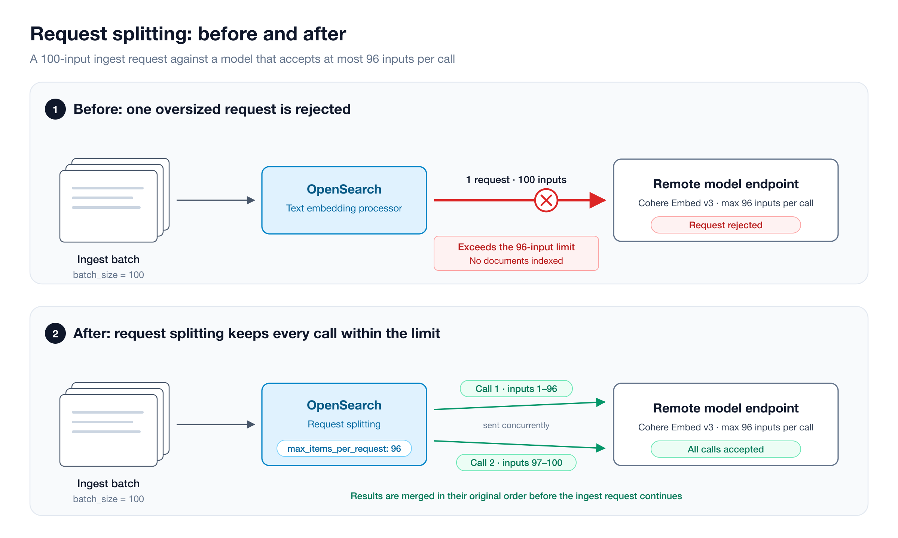
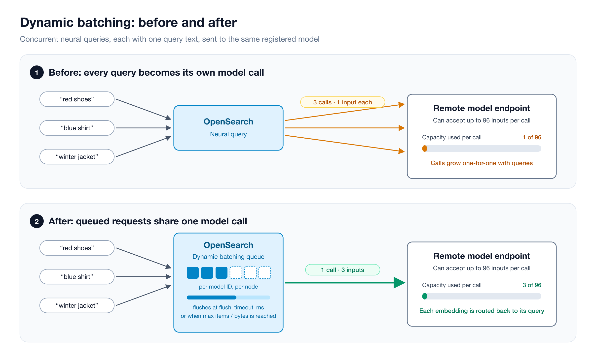

At low request volumes, remote inference is straightforward: OpenSearch sends input to a model and receives the result. As traffic increases, however, the size and frequency of requests can limit throughput.

During bulk ingestion, a single prediction request can exceed the model provider's limits and fail. During search, each query typically generates a separate model call. This creates many small remote calls, even when the endpoint can process multiple inputs in a single invocation.

OpenSearch 3.9 introduces model-level request batching for externally hosted models to address both problems:

- **Request splitting** divides oversized prediction requests into smaller model calls that stay within endpoint limits. This is particularly useful during bulk ingestion.
- **Dynamic batching** combines concurrent prediction requests into fewer, larger model calls. This improves endpoint utilization during search.

Both capabilities are configured for the registered model. This blog post explains how each capability works, how to configure it, and how to optimize it for your workload.

## Request splitting

During bulk ingestion, OpenSearch can send multiple documents in a single prediction request when using a [semantic field](https://docs.opensearch.org/latest/field-types/supported-field-types/semantic/) or the [text embedding processor](https://docs.opensearch.org/latest/ingest-pipelines/processors/text-embedding/). If the request contains more inputs or more data than the endpoint accepts, the provider rejects it.

Request splitting divides the prediction request into smaller model calls before sending them to the connector. OpenSearch reads the `text_docs` array in order and adds input strings to a model call until adding another string would exceed either the configured item-count or byte limit. It then sends that call and starts building the next one. This continues until all input strings have been assigned to a call.

OpenSearch sends the resulting model calls concurrently and combines their results in the original input order before continuing with the ingest request.

For example, [Cohere Embed English v3 on Amazon Bedrock](https://docs.aws.amazon.com/bedrock/latest/userguide/model-parameters-embed-v3.html) accepts at most 96 input strings per invocation. A prediction request containing 100 input strings exceeds that limit and fails. With request splitting, OpenSearch instead sends two model calls: one containing 96 input strings and another containing 4.

The following diagram shows the difference in behavior with and without request splitting.



However, item count alone does not determine whether a request fits within an endpoint's limits. For example, 96 short product titles might fit comfortably within the endpoint's payload limit, while 20 long articles might exceed it. Request splitting therefore supports two independent limits: the number of input strings and their combined byte size.

The registered model defines these limits in `batch_inference_config`:

- `max_items_per_request` specifies the maximum number of input strings in each model call.
- `max_bytes_per_request` specifies the maximum combined size of the input strings in each call.

The byte limit applies only to the input strings, not the entire connector request body. Set it below the provider's full payload limit to accommodate the additional fields in the request.

### Configure request splitting for ingestion

The following example registers an ingest model for [Cohere Embed English v3 on Amazon Bedrock](https://docs.aws.amazon.com/bedrock/latest/userguide/model-parameters-embed-v3.html), which accepts at most 96 input strings per call.

For an example that also configures `max_bytes_per_request`, see the [request splitting example](https://docs.opensearch.org/latest/ml-commons-plugin/remote-models/batching-requests/#configuring-request-splitting) in the documentation.

```json
POST /_plugins/_ml/models/_register?deploy=true
{
  "name": "cohere-embed-english-v3-ingest",
  "function_name": "remote",
  "connector_id": "<connector_id>",
  "batch_inference_config": {
    "max_items_per_request": 96
  }
}
```

### How to optimize request splitting for ingestion

Request splitting provides two separate controls that work together:

- The registered model's limits determine the maximum size of each model call.
- The ingest processor's `batch_size` determines how many documents OpenSearch includes in each prediction request.

Configure the model limits first, then optimize `batch_size` and the ingest load:

1. **Find the endpoint limits**: Identify the provider and exact model used by your connector. Use the [supported connectors](https://docs.opensearch.org/latest/ml-commons-plugin/remote-models/supported-connectors/) documentation to identify the model configuration. Then consult the provider's official documentation for its maximum item count and request payload size. For a custom endpoint, use the limits configured on the model server.

2. **Configure the model boundaries**: Set `max_items_per_request` to the endpoint's maximum item count. Set `max_bytes_per_request` below the endpoint's full payload limit because the connector adds other fields when constructing the request. These settings define the maximum size of an individual model call, not a throughput target.

3. **Start with one model-sized ingest batch**: The text embedding processor's `batch_size` determines how many documents go into each prediction request. Each field in `field_map` contributes one input string for each document. If a field contains an array, each element contributes a separate input string. Choose a `batch_size` that produces approximately `max_items_per_request` input strings for each prediction request. Request splitting then sends one model-sized call for each prediction request.

4. **Increase throughput by increasing the ingest load**: OpenSearch sends all prediction requests from a bulk request concurrently. Increasing `batch_size` alone does not necessarily increase throughput: it groups the same input strings into fewer, larger prediction requests, which request splitting then divides into model-sized calls. To increase throughput, send larger bulk requests or more bulk requests concurrently.

   Test with documents representative of your production workload, including both short and long texts. Long texts can reach the payload limit before reaching the item-count limit. Increase the load gradually while monitoring indexing throughput and request latency. Stop increasing it when throughput no longer improves or the provider begins rate-limiting requests, and use the previous load.

The model limits keep individual calls within the endpoint's boundaries. The processor's `batch_size` determines how many inputs OpenSearch receives in each prediction request, while the ingest load determines how many model calls can run concurrently.

## Dynamic batching

A [neural query](https://docs.opensearch.org/latest/query-dsl/specialized/neural/) typically generates a prediction request containing a single query text. When multiple searches arrive concurrently, OpenSearch can generate many model calls, each containing one input string.

This approach can underutilize the endpoint. Even if the endpoint can process several query texts in a single invocation, it must process each separate model call independently.

Dynamic batching addresses this problem by collecting concurrent prediction requests and combining their input strings into a shared model call.

OpenSearch maintains a separate collection window for each registered model on each node. The first prediction request starts the window. As additional requests arrive, OpenSearch groups requests that use the same model and prediction settings, where `text_docs` is the only field that differs.

OpenSearch collects the input strings until either the configured item-count or byte limit is reached. When either limit is reached, it sends the batch immediately. Otherwise, it sends the batch when the configured `dynamic_batching.flush_timeout_ms` expires.

When the model returns its results, OpenSearch uses the stored positions to route each output to the original prediction request.

For example, three searches might independently submit the query texts `red shoes`, `blue shirt`, and `winter jacket`. If the requests arrive within the same collection window and use the same model settings, OpenSearch can combine the three input strings into one model call. Each search still receives only the embedding corresponding to its own query text.

The following diagram shows the difference in behavior with and without dynamic batching.



### Configure dynamic batching for search

Configure dynamic batching on a separate search model. This model can reference the same connector as the ingest model, but uses a short collection window to accommodate search latency.

The following example registers a search model with a maximum collection window of 10 ms. We use this configuration in the following benchmark.

```json
POST /_plugins/_ml/models/_register?deploy=true
{
  "name": "cohere-embed-english-v3-search",
  "function_name": "remote",
  "connector_id": "<connector_id>",
  "batch_inference_config": {
    "max_items_per_request": 96,
    "dynamic_batching": {
      "enabled": true,
      "flush_timeout_ms": 10
    }
  }
}
```

### Throughput improvement during concurrent search traffic

We tested dynamic batching on a three-node cluster running locally on a single machine, using Amazon Bedrock with Cohere Embed English v3. Each prediction request contained one query text.

Without dynamic batching, 300 concurrent requests generated 300 model calls. With a 10 ms collection window, OpenSearch combined the requests into 23 model calls, averaging approximately 13 input strings per call.

We then configured the connector's `client_config.max_connection` setting to `1`, limiting each node to one concurrent model call. We sent 200 concurrent query embedding requests with the same 10 ms collection window.

This configuration made the number of model calls a limiting factor, allowing us to measure the impact of combining requests before they reached the endpoint.

| Metric | Without dynamic batching | With dynamic batching |
| :--- | ---: | ---: |
| Model calls | 200 | 27 |
| Time to complete the workload | 14.66 seconds | 3.96 seconds |
| Throughput | 13.6 queries/s | 50.5 queries/s |

Dynamic batching reduced the number of model calls by 7.4 times and increased throughput by 3.7 times in this workload. The improvement resulted from combining concurrent requests that arrived close enough together to share a model call.

### How to optimize dynamic batching for search

Dynamic batching uses the same model limits as request splitting, but addresses a different problem. Request splitting divides a single oversized prediction request. Dynamic batching collects independent search requests and combines their inputs into a shared model call.

The model limits define the maximum size of the shared call. The `dynamic_batching.flush_timeout_ms` setting determines how long OpenSearch waits for additional requests before sending the batch.

Follow these steps to optimize dynamic batching:

1. **Configure the shared-call limits**: Obtain the item-count and payload limits from the provider's official documentation for the exact model. For a custom endpoint, use the limits configured on the model server. Set `max_items_per_request` and `max_bytes_per_request` to define the maximum size of a shared model call. OpenSearch sends the batch as soon as either limit is reached.

2. **Choose an initial timeout based on your latency budget**: The `dynamic_batching.flush_timeout_ms` setting specifies the maximum additional time OpenSearch waits for the first request in a batch. Its default value is `50` ms. Start with a timeout that fits within your search latency budget. For example, if your workload can tolerate up to 10 ms of additional waiting, start with `10`. A longer timeout can collect more requests, but it also increases latency when traffic is low.

3. **Estimate how many requests can join a batch on each node**: Dynamic batching maintains a separate batch for each model ID on each OpenSearch node. For example, a node receiving approximately 1,000 query embedding requests per second can receive roughly 10 requests during a 10 ms collection window.

   Requests sent to different nodes, using different model IDs, or using different prediction settings cannot join the same batch. Therefore, use the request rate received by an individual node when choosing the timeout, not the total request rate across the cluster.

4. **Adjust the timeout based on observed performance**: Compare endpoint invocation counts, query throughput, and query latency under both peak and low traffic conditions. If the number of endpoint calls remains close to the number of search requests and your latency budget allows additional waiting, increase the timeout in small increments. If query latency exceeds your budget, reduce it.

   If batches already reach `max_items_per_request` before the timeout expires, increasing the timeout will not make them larger and is unlikely to improve throughput.

The timeout controls the trade-off between added latency and fewer endpoint calls. Choose the shortest wait that produces enough shared model calls to meet your search throughput requirements.

## Next steps

To configure request splitting or dynamic batching on your models, see [Batching requests to externally hosted models](https://docs.opensearch.org/latest/ml-commons-plugin/remote-models/batching-requests/) in the OpenSearch documentation. If you have questions or feedback, join the discussion on the [OpenSearch forum](https://forum.opensearch.org/).