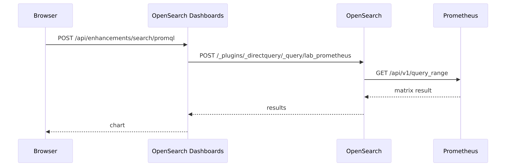
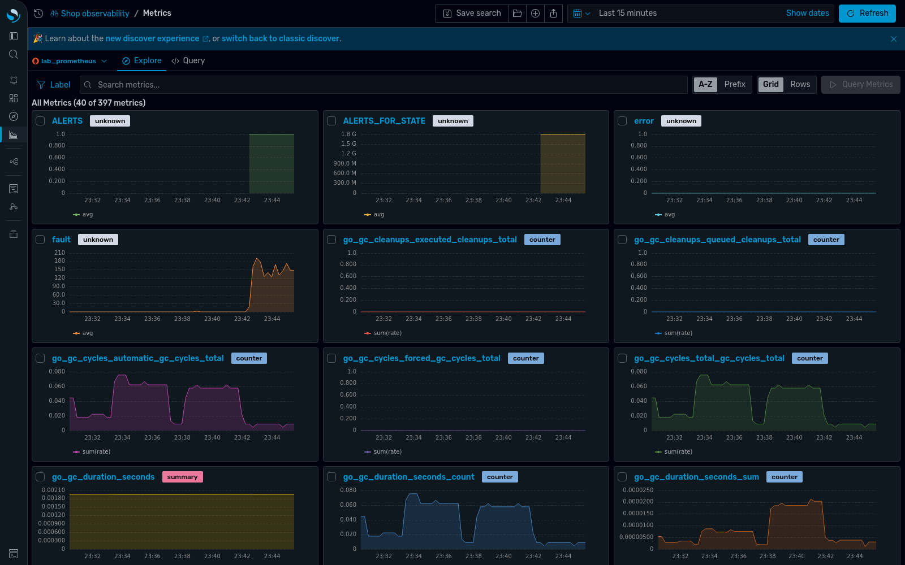
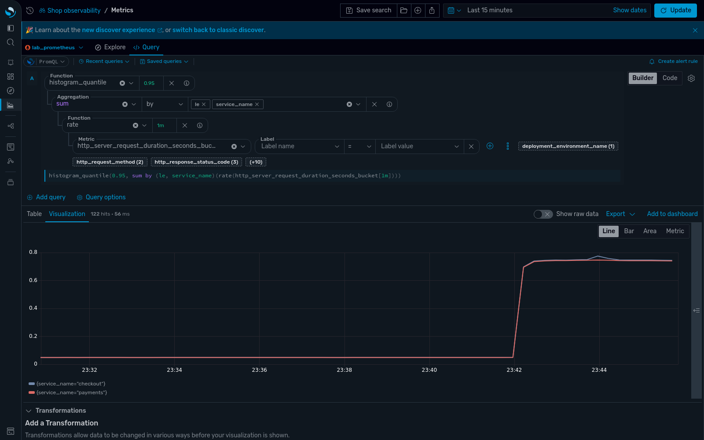
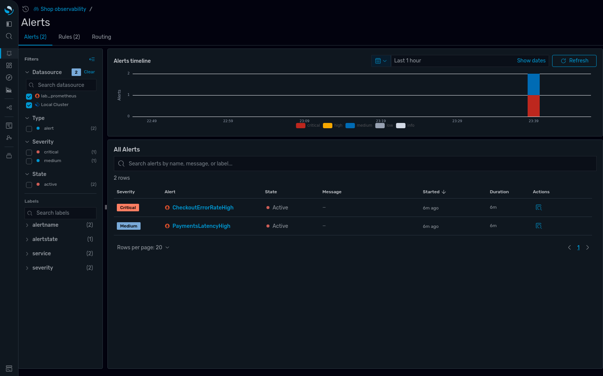
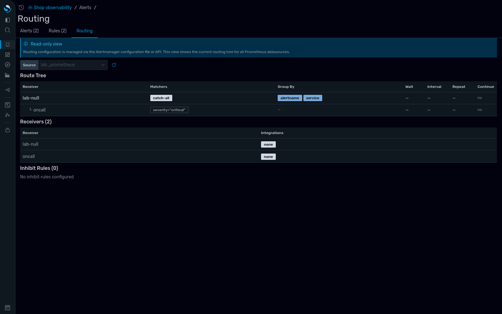
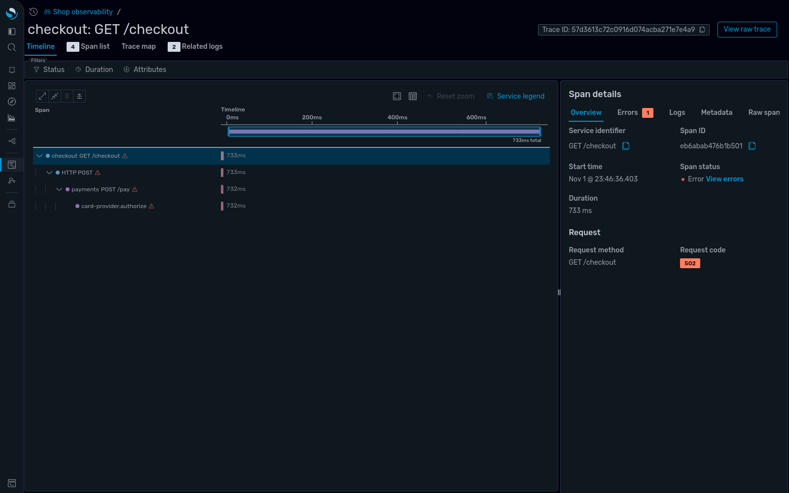
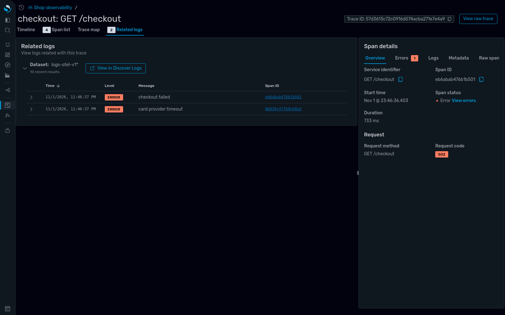

I've worked on a server monitoring platform for AI data centers. During incidents, much of the time went to moving between tools. You spot a latency spike in one place, then go looking for the matching trace and error message in another. OpenSearch Dashboards can now query Prometheus directly with PromQL, next to logs and traces stored in OpenSearch, and you don't have to move your metrics to use it. To see how well that works, I built a small lab that mimics a common setup: Prometheus for metrics, and OpenSearch for logs and traces.

The [OpenSearch 3.7 release post](https://opensearch.org/blog/explore-opensearch-3-7/) covers what the feature is. In this post, I'll focus on using it: I'll break a service on purpose and follow the fault from a PromQL query to a log line, trace how the query reaches Prometheus, test who can run it when the Security plugin is enabled, and describe two setup steps that cost me time.

All results come from OpenSearch 3.9.0, OpenSearch Dashboards 3.9.0, Data Prepper 2.16.0, Prometheus 3.15.1, and the OpenTelemetry Collector 0.164.0, running in Docker on a laptop. The full lab, including every configuration file, is available in the [`opensearch-prometheus-lab` repository](https://github.com/mohiadeen-ameer/opensearch-prometheus-lab).

## The lab: One Collector, two storage engines

The application is a two-service shop written in Go and instrumented with the OpenTelemetry SDK. The `checkout` service calls `payments`, which calls a simulated card provider. A load generator sends steady traffic, and the `payments` service exposes a `/chaos` endpoint that adds latency and errors on demand.

The following diagram shows how each signal travels. The OpenTelemetry Collector sends traces and logs to Data Prepper, which writes them to OpenSearch. Metrics go directly to Prometheus through its native OpenTelemetry Protocol (OTLP) receiver. Data Prepper also derives rate, error, and duration (RED) metrics from spans and remote-writes them to Prometheus for the application performance monitoring (APM) pages. Prometheus sends firing alerts to `Alertmanager`, and OpenSearch reads both for the alerting pages.

{:class="img-centered"}

Connecting Prometheus takes one API call to OpenSearch Dashboards:

```bash
curl -X POST localhost:5601/api/directquery/dataconnections \
  -H 'osd-xsrf: true' -H 'Content-Type: application/json' -d '{
  "name": "lab_prometheus", "connector": "prometheus", "allowedRoles": [],
  "properties": {
    "prometheus.uri": "http://prometheus:9090",
    "alertmanager.uri": "http://alertmanager:9093"
  }
}'
```

The new experience also needs an Observability workspace and the `explore` settings in `opensearch_dashboards.yml`. The lab's `setup.sh` script creates both. For all options, see [Analyzing metrics in Discover](https://docs.opensearch.org/latest/observing-your-data/exploring-observability-data/discover-metrics/).

## Where a PromQL query goes

Before running the investigation, I wanted to know which component talks to Prometheus. I assumed it was OpenSearch Dashboards, and I was wrong. I recorded the requests that the browser sends and then read the OpenSearch Dashboards server code that handles them. The following diagram shows the path of a single PromQL query.

{:class="img-centered"}

OpenSearch, not OpenSearch Dashboards, is the proxy. The Prometheus connection is stored in the OpenSearch SQL plugin's data source registry, which is why the cluster needs the `plugins.query.datasources.encryption.masterkey` setting: the plugin uses that key to encrypt stored data source credentials. That also means access to the connection can be controlled in OpenSearch, which I test later in this post.

You can call the same API yourself. OpenSearch sends PromQL to Prometheus rather than translating it, so the queries I copied from my rules behaved the same way:

```bash
curl -X POST localhost:9200/_plugins/_directquery/_query/lab_prometheus \
  -H 'Content-Type: application/json' -d '{
  "query": "sum by (result) (rate(shop_orders_total[1m]))",
  "language": "promql",
  "options": { "queryType": "instant", "time": "'"$(date +%s)"'" }
}'
```

## Following an incident from a metric to a log line

With traffic flowing, I made the card provider slow and unreliable:

```bash
curl "localhost:8081/chaos?latency_ms=700&error_rate=0.25"
```

This is the easy case: one injected fault, and both services slow down at once. I started from a PromQL query, and every step stayed inside one OpenSearch Dashboards workspace.

### Step 1: Spot the problem in metrics

In **Discover > Metrics**, the **Explore** mode found every metric name in Prometheus (397 in this lab) once the connection existed and drew a small chart for each one. The following image shows the Explore mode.



Next, I switched to **Query** mode and entered a p95 latency query. The visual builder and the code editor stay in sync, so the builder splits the expression into function, aggregation, and metric steps. If you are still learning PromQL, this is a useful way to see how an expression is structured:

```promql
histogram_quantile(0.95,
  sum by (le, service_name) (rate(http_server_request_duration_seconds_bucket[1m])))
```

The following chart shows p95 latency for both services jumping from about 50 ms to about 750 ms when the fault starts.



The `service_name` label exists because Prometheus is configured to promote the OpenTelemetry `service.name` resource attribute to a label (`otlp.promote_resource_attributes` in `prometheus.yml`). The same `service.name` value is stored on every span and log in OpenSearch. That shared key is what lets you move between signals, so set it up from the start.

### Step 2: Check which alerts fired

Both Prometheus alerting rules in the lab fired within about two minutes (each rule waits for one minute before firing). The **Alerts** page, part of the experimental unified alerts view, lists Prometheus alerts with their severity, state, and labels, next to OpenSearch alerting monitors, and you can filter by data source. The following image shows the two active alerts.



The **Routing** tab shows a read-only view of the `Alertmanager` routing tree, which helps you answer "who was notified?" without opening `Alertmanager`. The following image shows the lab's routing tree.



### Step 3: Find the slow span

In **Discover > Traces**, I filtered for failed requests and opened one. The following waterfall shows that every span in the request takes about 733 ms and that the deepest span, `card-provider.authorize`, is where the time goes.



### Step 4: Read the related logs

The **Related logs** tab on the same trace shows the log lines written during that request, joined on the trace ID. The following image shows one error log from each service, including the root cause: a card provider timeout.



In this lab, with one injected fault, it took four steps to get from a latency spike to the error message without opening another tool. A real incident will have noisier metrics, more suspects, and possibly sampled traces, so I'd treat this as the best case.

## Controlling who can query Prometheus

The Security plugin is disabled in the main lab, so I tested access separately on a second OpenSearch 3.9.0 node with the plugin enabled. The `security-test` folder in the lab repository starts that node and runs the same test. I created a data connection with `"allowedRoles": ["promreaders"]` and sent the same PromQL query through the API as three users.

| User | Direct query permissions | In `promreaders` | Result |
| :--- | :--- | :--- | :--- |
| `alice` | Yes | Yes | Returned data |
| `bob` | Yes | No | HTTP 200 with an empty result |
| `carol` | No | No | HTTP 403 |

So two layers apply: the cluster permission decides whether you can call the API, and `allowedRoles` decides which connection returns data. If someone reports an empty result, check `allowedRoles` first, because the response isn't an error. Getting the connection through the API returned the authentication type but not the username or password.

This doesn't protect Prometheus itself. Anyone who can reach its HTTP port can still query it directly, so restrict network access too. I only tested the API, not OpenSearch Dashboards with security enabled, so tenants and workspace permissions remain open questions for me.

## Two setup steps that cost me time

Setup was straightforward once I knew the steps, but there are several: the data connection, an encryption key, an Observability workspace, the `explore` settings, and the datasets. These two cost me the most time.

### Creating alert rules requires a Prometheus backend with a ruler API

OpenSearch 3.9 has a form for building an alert rule from a PromQL query without writing YAML. When I submitted the form against open-source Prometheus, the form reported that the rule's configuration was invalid and asked me to correct the highlighted fields. The rule was fine. The OpenSearch log showed the real reason: `Ruler request failed with code: 404`. Open-source Prometheus loads rules from files and has no API for writing them.

Reading rules works: the **Alerts** and **Rules** tabs showed the lab's file-based rules. To create rules from OpenSearch Dashboards, use a backend that provides a ruler API, such as Cortex, Grafana Mimir, or Amazon Managed Service for Prometheus, and set it as `prometheus.ruler.uri` on the data source. The [OpenSearch Observability Stack](https://github.com/opensearch-project/observability-stack) uses Cortex this way. I read that configuration but didn't test a ruler-enabled backend myself.

### Refresh the field list of datasets that you create using the API

This was my wrong turn. I created the logs and traces datasets with the saved objects API. Discover showed `Could not locate that index-pattern-field (id: time)`, and the **Related logs** tab showed nothing. I assumed my logs had no trace IDs, but they did, and the same query returned both log lines when I ran it directly.

Datasets created using the API start with an empty field list. The fix is to load the fields once with `GET /api/index_patterns/_fields_for_wildcard` and save them on the dataset. The lab's `setup.sh` script does this, so run it after data has started arriving.

## What I didn't test

This was a small test, so treat these results as a starting point. The lab runs a single OpenSearch node and one Prometheus server, with one injected fault and steady, moderate traffic. This post doesn't cover performance. I didn't test authentication to Prometheus, high-availability or federated Prometheus setups, a ruler-enabled backend, PromQL dashboards, or the service-level objective catalog.

## One place to investigate, two places to store

The surprise for me was how little changes on the Prometheus side. OpenSearch doesn't store these metrics; it forwards PromQL to Prometheus and shows the results next to your logs and traces. My Prometheus rules kept working, and I didn't move any data. I think that's the right starting point, because you can try it without committing to a migration. If you already run OpenSearch Dashboards for logs and traces, it also means one less UI to run for metrics.

If you want a single store instead, the [Time-Series Database plugin](https://github.com/opensearch-project/time-series-db) and the `index_type: tsdb` sink option in [Data Prepper 2.16](https://opensearch.org/blog/data-prepper-2-16/) store metrics in OpenSearch itself. I haven't tested that option yet.

## Next steps

To try the integration yourself, run the lab:

```bash
git clone https://github.com/mohiadeen-ameer/opensearch-prometheus-lab
cd opensearch-prometheus-lab
docker compose up -d --build
sleep 60 && ./setup.sh
curl "localhost:8081/chaos?latency_ms=700&error_rate=0.25"
```

Then open `http://localhost:5601`, select the **Shop observability** workspace, and follow the same four steps.

Before you adopt the integration:

- If you want to create alert rules from OpenSearch Dashboards, make sure your Prometheus backend provides a ruler API.
- Make sure that `service.name` is promoted to a Prometheus label so that you can correlate metrics with traces and logs.

To learn more, see [Analyzing metrics in Discover](https://docs.opensearch.org/latest/observing-your-data/exploring-observability-data/discover-metrics/) and the [OpenSearch Observability Stack](https://opensearch.org/platform/observability-stack/). If you reproduce or extend these results, share them on the [OpenSearch forum](https://forum.opensearch.org/) or open an issue in the [lab repository](https://github.com/mohiadeen-ameer/opensearch-prometheus-lab).
